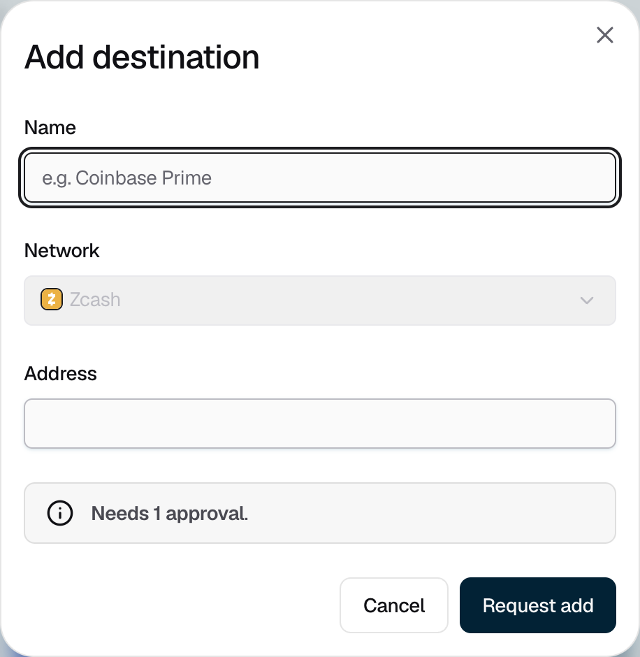

<Info>Requires the Owner or Admin role. Each new address is an approval request, decided by your **Add address** policy.</Info>

## Adding an address

<Steps>
  <Step title="Open the address book">
    Click your name at the bottom of the sidebar, then **Settings**. Stay on **Address book** and click **Add destination**.
  </Step>
  <Step title="Enter the address">
    Enter a **Name** of up to 60 characters, choose the **Network**, and paste the **Address**. The dialog shows how many approvals the address needs.

    <Frame caption="Figure 1: The dialog shows how many approvals the new address needs.">
      
    </Frame>
  </Step>
  <Step title="Request it">
    Click **Request add**. The address shows **Pending** until approvers approve it. Approvers see its name, network and full address on their iPhone.
  </Step>
</Steps>

To cancel your own pending add, click the **…** menu on its row, then **Withdraw request**.

## If it does not work

| What you see | What to do |
|---|---|
| "Enter a name." or "Enter an address." | Fill in the missing field. |
| "Use 60 characters or fewer." | Shorten the name. |
| "Another address already has this name." | Choose a different name. |
| "Already in the address book as …" | The address is saved under another name. Use that entry. |
| "Not a valid Zcash address." | Check that the address matches the network you chose. |
| "This network can't be used for the address book." | Choose a [supported network](/portfolio/supported-networks). |
| "This is one of your organization's own wallet addresses. Send to it directly; it doesn't need an entry." | Choose **Internal transfer** when you send to it. |
| "Your role can view the address book but can't change it." | Ask an Owner or Admin to add the address. |
