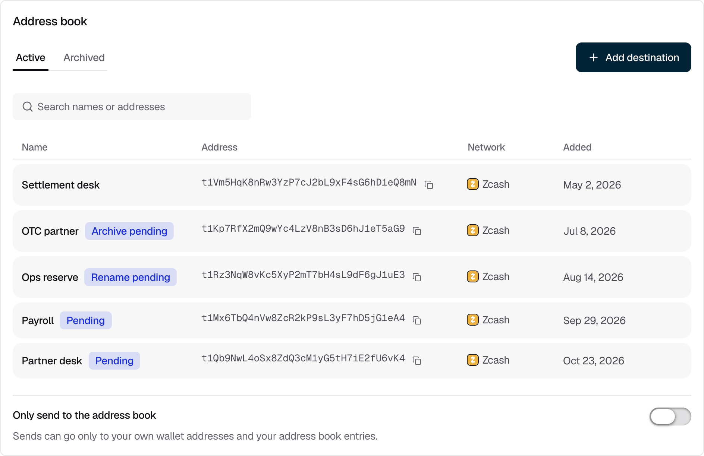

When you [send funds](/portfolio/send-funds), you choose one of three kinds of destination:

- **Internal transfer** sends to another of your organization's wallets on Strongpoint.
- **Address book** sends to an external address your organization has saved and approved.
- **External transfer** sends to any other external address, pasted in at send time.

The address book is where you keep the trusted external addresses you send to regularly, such as an exchange account or a partner's wallet. It gives you three things:

- **Saved, named addresses.** You pick an address by name instead of pasting it, and approvers see that name on the send.
- **An extra approval.** Adding an address to the address book is an approval request of its own. Approvers check the address once when it's saved, on top of checking each send.
- **An optional restriction.** You can [allow external sends only to saved addresses](/address-book/restrict-sends), so no one can paste an unknown address.

To open it, click your name at the bottom of the sidebar, then **Settings**. The address book is the first tab.

<Frame caption="Figure 1: Saved addresses, with changes still waiting for approval.">
  
</Frame>

## Who can change it

Owners and Admins add, rename and archive addresses. Every role can view the address book.

{/* TK: Tyler (Nov 2026) says Owners and Admins control the address book. In the code, Operators can also request adds, renames and archives (rs/authz/cedar/policies.cedar, operator-custody-operate). */}

## Policies

| Change | Policy |
|---|---|
| Add an address | **Add address** |
| Rename an address | **Rename address** |
| Archive an address | **Archive address** |
| Turn **Only send to the address book** on or off | **Change approval rule** |

Until you set them, the three address policies follow your **Organization default**. See [Change a policy](/policies-and-approvals/change-policy).

## Statuses

| Status | Meaning |
|---|---|
| **Pending** | The add is waiting for approval. The address can't be used yet. |
| **Rename pending** | The new name is waiting for approval. |
| **Archive pending** | The archive is waiting for approval. Sends can still use the address. |

An address with no status is ready to use. If a pending request waits for your approval, click its status to open it in **Approvals**.

## Tasks

<CardGroup cols={3}>
  <Card title="Add an address" icon="plus" href="/address-book/add-address">
    Save a new destination.
  </Card>
  <Card title="Rename or archive an address" icon="pen" href="/address-book/rename-or-archive">
    Change a name, or retire an address.
  </Card>
  <Card title="Restrict sends to the address book" icon="lock" href="/address-book/restrict-sends">
    Allow sends only within Strongpoint or to saved addresses.
  </Card>
</CardGroup>
