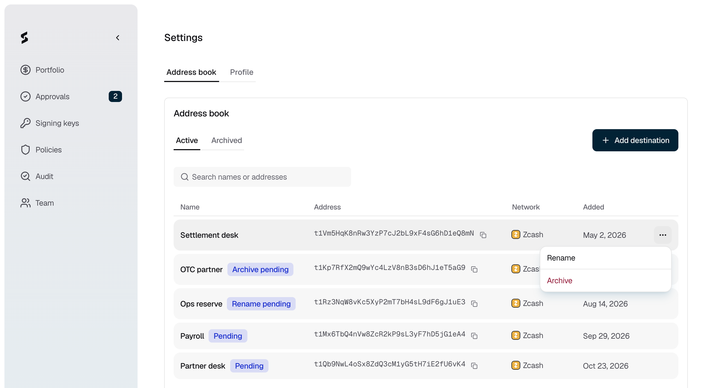
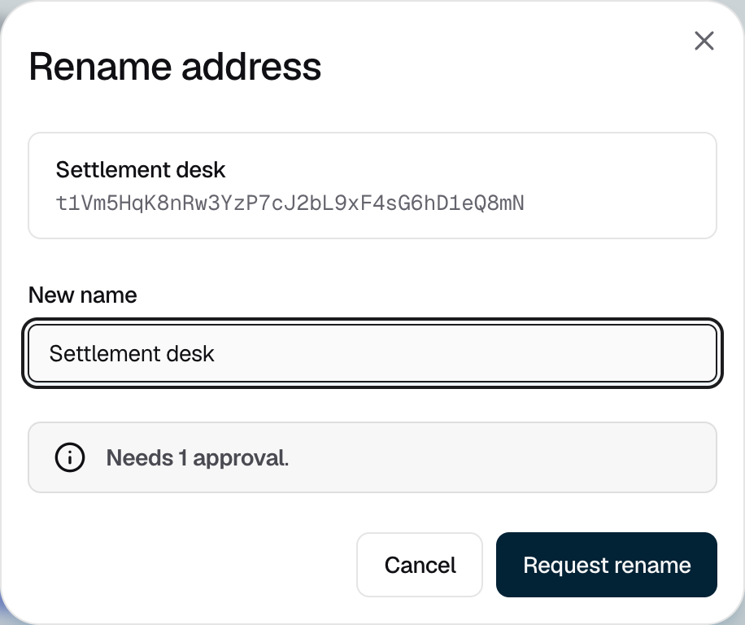

<Info>Requires the Owner or Admin role. Each change is an approval request, decided by your **Rename address** or **Archive address** policy.</Info>

Both actions start from the **…** menu on the address's row.

<Frame caption="Figure 1: The menu on a saved address.">
  
</Frame>

## Renaming an address

Click the **…** menu on the address's row, then **Rename**. Enter the **New name** and click **Request rename**. The address shows **Rename pending** until approvers approve. Its address and network stay the same.

<Frame caption="Figure 2: A rename needs approval before it applies.">
  
</Frame>

## Archiving an address

Click the **…** menu on the address's row, then **Archive**, and click **Request archive**. Once approved, the address moves to the **Archived** tab, and new sends can't use it. Archiving can't be undone, so to use the address again, [add it](/address-book/add-address) as a new entry.

## If it does not work

| What you see | What to do |
|---|---|
| "That's already its name." | Enter a different name. |
| "Another address already has this name." | Choose a different name. |
| **Rename** or **Archive** is missing from the menu | A request of that kind is already open for this address. Check **Approvals**. |
