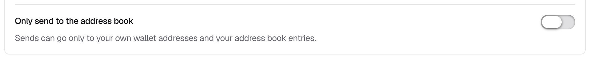

<Info>Requires the Owner or Admin role. Turning the setting on or off is an approval request, decided by your **Change approval rule** policy.</Info>

When **Only send to the address book** is on, sends can go only to your organization's wallets on Strongpoint and to saved addresses. **External transfer** no longer appears as an option when you [send funds](/portfolio/send-funds).

## Changing the setting

<Steps>
  <Step title="Open the address book">
    Click your name at the bottom of the sidebar, then **Settings**. The address book is the first tab.
  </Step>
  <Step title="Locate the switch">
    Scroll below the list of addresses to **Only send to the address book**.

    <Frame caption="Figure 1: The switch is below the list of saved addresses.">
      
    </Frame>
  </Step>
  <Step title="Turn it on or off">
    Click the switch. It shows "Turning on · awaiting approvals" or "Turning off · awaiting approvals", and stays locked until approvers decide.
  </Step>
  <Step title="Wait for approvals">
    The change doesn't take effect until enough approvers approve it under your [**Change approval rule** policy](/policies-and-approvals/policies). Follow the request on the **Approvals** page.
  </Step>
</Steps>

The setting applies to new sends only. Sends already requested aren't checked again.

## If it does not work

| What you see | What to do |
|---|---|
| The switch is greyed out | Your role can't change it. Ask an Owner or Admin. |
| "The switch already holds that value, or the change was already decided." | Refresh the page, check the setting, then try again. |
| "Couldn't request the change. Try again." | Try again. If it keeps happening, contact [Strongpoint support](mailto:support@strongpoint.projecteleven.com). |
