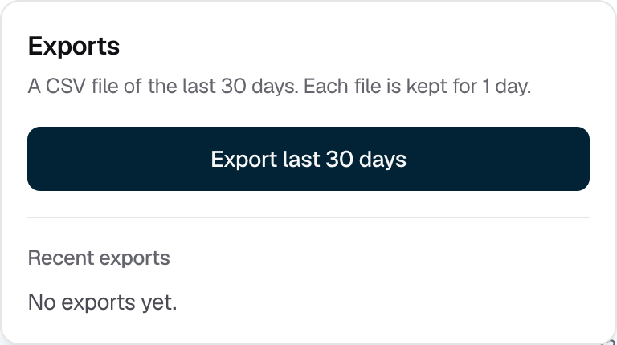

<Info>Requires the Owner, Admin or Auditor role. Exporting needs no approval.</Info>

## Exporting the log

<Steps>
  <Step title="Open the export panel">
    Go to **Audit** and click **Export log**.
  </Step>
  <Step title="Start the export">
    Click **Export last 30 days**. The export shows **Preparing** under **Recent exports** while Strongpoint builds the file.

    <Frame caption="Figure 1: Each export covers the last 30 days.">
      
    </Frame>
  </Step>
  <Step title="Download the file">
    When the export shows **Ready**, click **Download**. The file is kept for 1 day, then shows **Expired**. Download it again by starting a new export.
  </Step>
</Steps>

## What the file contains

Each row is one entry, with these columns:

| Column | What it holds |
|---|---|
| `timestamp` | When the action happened |
| `seq` | The entry number, as shown in the console |
| `action` | What happened |
| `status` | Whether it succeeded, was denied or failed |
| `actor_type`, `actor_id`, `actor_name`, `actor_email` | Who did it, or Strongpoint for automatic actions |
| `resource_type`, `resource_id` | What it acted on |
| `request_id` | The request it belongs to |
| `details` | The action's details |
| `entry_hash` | The entry's fingerprint |

The `seq` and `entry_hash` columns let you match each row to its entry in the console.

## If it does not work

| What you see | What to do |
|---|---|
| "An export is already running" | Wait for the running export to finish. |
| "The export didn't start." | Click **Try again**. |
| **Failed**, with "The export didn't complete" | Start a new export. |
| "The download didn't start. Try again." | Click **Download** again. If the export shows **Expired**, start a new one. |
| "Your role cannot export the audit log." | Ask an Owner, Admin or Auditor to export it. |
