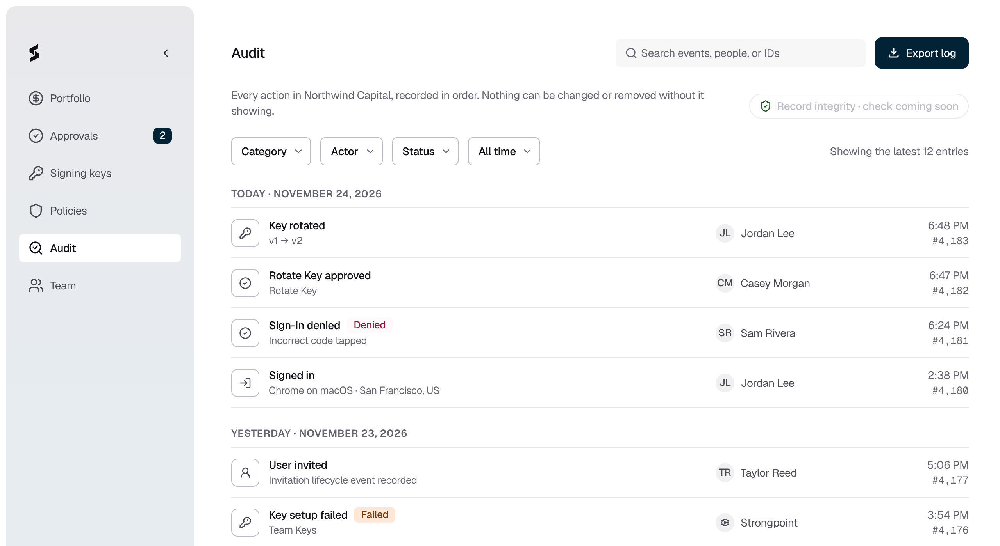

The audit trail records what happens in your organization, in order: who did what, when, and whether it worked. Strongpoint writes each entry as the action happens, and no one can change or remove an entry without it showing, including Strongpoint.

<Info>Owners, Admins and Auditors can view and export the audit trail.</Info>

<Frame caption="Figure 1: The audit trail, newest entries first.">
  
</Frame>

## What it records

Every sign-in, approval decision, send, policy change, member change and key change gets an entry. Actions Strongpoint takes on its own, such as setting up a key, show **Strongpoint** as the actor. Attempts that were refused are recorded too, marked **Denied** or **Failed**.

Go to **Audit** to see the trail. Search for an event, a person or an ID, or filter by **Category**, **Actor**, **Status** and time. Click an entry to see its details.

## How the record stays intact

- **Each entry is linked to the one before it.** Every entry carries a fingerprint, a SHA3-256 hash, that covers the previous entry's fingerprint. Editing, removing or reordering an entry breaks every link after it, so the change shows. An entry's details show its **Fingerprint** and the entry it's **Linked to**.
- **The latest position is signed and locked away.** Strongpoint regularly signs the newest fingerprint in your trail with a post-quantum signature (ML-DSA-87). It stores each signed copy in storage locked for 100 years, which no one can delete or shorten, including Strongpoint. A signed copy proves that the trail up to that point hasn't been rewritten since.
- **Your trail is separate.** Each organization has its own chain of entries.

{/* TK: the console's entry details still say each entry "is signed" and show "Signed with … audit key". In the code (rs/kms/src/audit_signer.rs), the audit key no longer signs entries; it signs only the chain head anchors described above. Customers can't fetch anchors yet, and the Audit page shows "Record integrity · check coming soon". */}

## How long entries are kept

Entries are kept for 1 year. After that, an entry's content is removed and a placeholder takes its place, marked **Entry redacted**. The placeholder keeps its place in the chain, so the record still checks out from end to end.

## Tasks

<CardGroup cols={2}>
  <Card title="Export the audit log" icon="file-csv" href="/audit/export-audit-log">
    Download the last 30 days as a CSV file.
  </Card>
</CardGroup>
