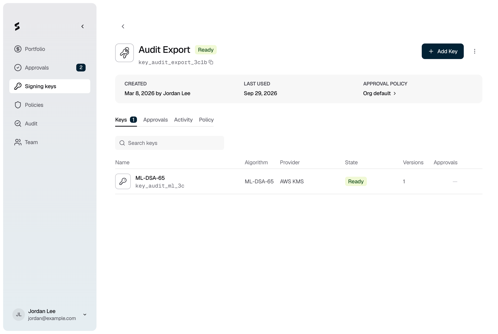

<Info>Requires the Owner or Admin role. Adding a key needs no approval, except on a PEAK key ring.</Info>

Add a key to sign with another algorithm, for example to pair a classical key with a post-quantum one. Each new key adds one more signature to every signing request.

## Adding a key

<Steps>
  <Step title="Open the key ring">
    Go to **Signing keys** and click the key ring.

    <Frame caption="Figure 1: A key ring and its keys.">
      
    </Frame>
  </Step>
  <Step title="Choose the key">
    Click **Add Key**. Choose an **Algorithm** and a **Provider** for each key you want. Click **Add another key** to add several at once. A PEAK key ring offers only PEAK, and other key rings offer only AWS KMS.
  </Step>
  <Step title="Add it">
    Click **Add keys**. Each key shows **Provisioning** until it is ready. Check the results, then close the dialog.
  </Step>
</Steps>

On a PEAK key ring, the console shows **Approval requested** instead. The key is created once approvers approve it under your **Add key** policy and the key ring's holders contribute on their devices.

## If it does not work

| What you see | What to do |
|---|---|
| "Weaker than this key ring's strongest ready key" | A warning only. The new key uses a weaker algorithm than a key already in the key ring. You can still add it. |
| "Restricted by this key ring's provider policy" | The key ring can't use that provider. Choose another provider. |
| "Keys can only be added while this key ring is ready." | [Enable the key ring](/kms/disable-or-delete-key) first. |
| "Keys can be added to a PEAK key ring once its root is established." | Wait until the key ring's holders have joined on their devices. |
| **Created, but provisioning failed** | The provider could not create the key. Add a new key to try again. |
