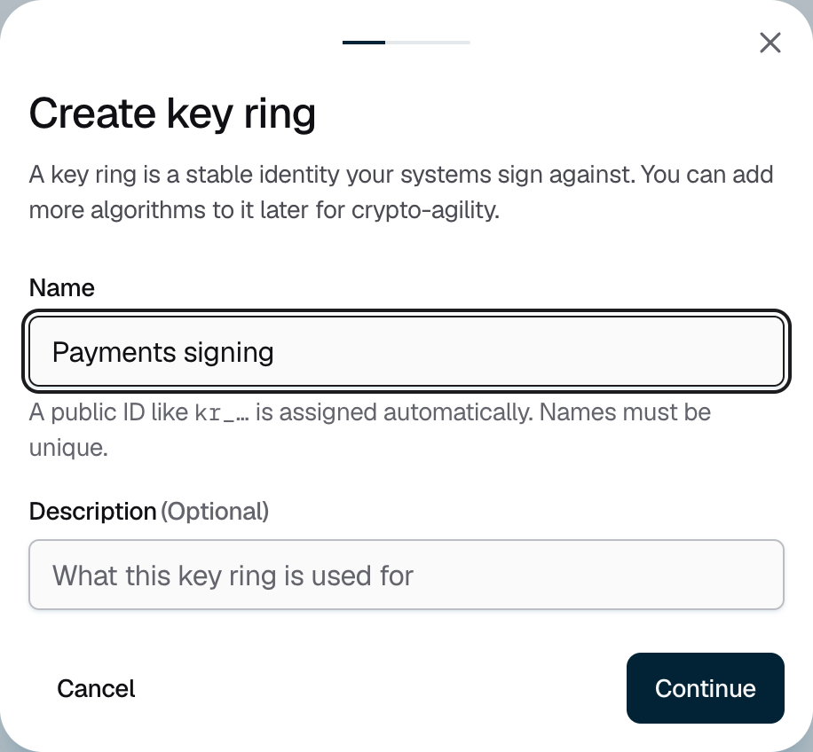
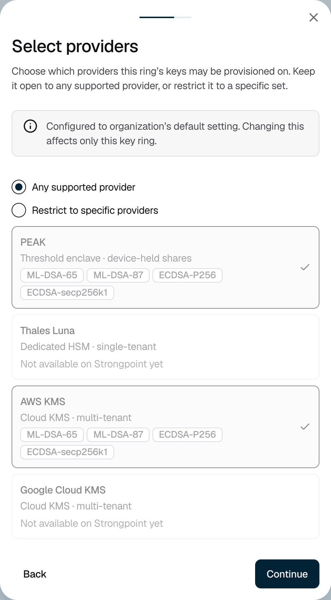
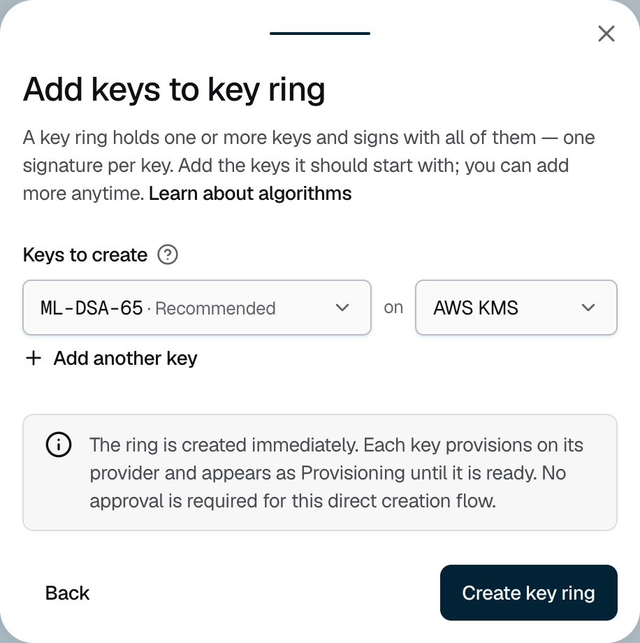

<Info>Requires the Owner or Admin role. Creating a key ring needs no approval, except for a PEAK key ring.</Info>

## Creating a key ring

<Steps>
  <Step title="Name the key ring">
    Go to **Signing keys** and click **Create Key Ring**. Enter a **Name**, for example "Payments signing", and optionally a **Description**. Then click **Continue**.

    <Frame caption="Figure 1: Key ring names must be unique in your organization.">
      
    </Frame>
  </Step>
  <Step title="Choose the providers">
    Keep **Any supported provider**, or choose **Restrict to specific providers** and select the ones its keys may use. You can't change this later. Then click **Continue**.

    <Frame caption="Figure 2: AWS KMS and PEAK are available today.">
      
    </Frame>
  </Step>
  <Step title="Choose its first keys">
    Each row is one key: choose an **Algorithm** and a **Provider**. The first row starts as ML-DSA-65 on AWS KMS, the recommended choice. To sign with more than one algorithm, click **Add another key**. See [Algorithms and providers](/kms/algorithms-and-providers).

    <Frame caption="Figure 3: Each row creates one key.">
      
    </Frame>
  </Step>
  <Step title="Create it">
    Click **Create key ring**. The key ring is ready right away. Each key shows **Provisioning** until its provider has created it, then **Ready**. Click **View key ring** to open it.
  </Step>
</Steps>

## PEAK key rings

A PEAK key ring keeps its keys in shares on your members' iPhones. It needs your organization's root key first. An Owner sets it up on the **Root key** tab of **Signing keys**: click **Set up root key**, choose the holders, then click **Confirm and request root key**. Every holder approves on their iPhone, then accepts their share.

To create the key ring, choose **Restrict to specific providers** and select only **PEAK**. The last step becomes **PEAK key holders**: choose who holds a share of the key ring's recovery key, and how many must join. Then click **Create key ring**. Once the holders have joined on their iPhones, you can [add keys](/kms/add-key).

{/* TK: document PEAK setup end to end on the PEAK reference page. */}

## If it does not work

| What you see | What to do |
|---|---|
| "A key ring with this name already exists." | Choose another name. |
| "Enter a name of at least 2 characters." | Names need 2 to 200 characters. |
| "Establish the organization key in Signing Keys › Root key before creating a PEAK key ring." | Click **Open Root key**. An Owner must set up the root key first. |
| "The organization key is still being established." | Wait until every root key holder has accepted their share on their iPhone. |
| A key shows **Provisioning failed** | The provider could not create the key. [Add a key](/kms/add-key) to try again. |
| "The result of this request is unknown." | Click **Retry**. Retrying can't create a duplicate key ring. |
| "You do not have permission to create key rings in this organization." | Ask an Owner or Admin to create it. |
