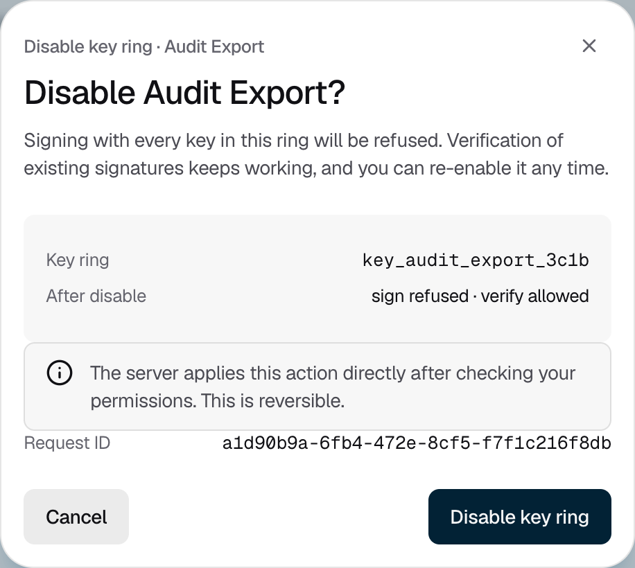

<Info>Requires the Owner or Admin role. Disabling, enabling and deleting need no approval.</Info>

## Disabling a key or key ring

Disable a key or a key ring to stop it signing. You can enable it again at any time.

<Steps>
  <Step title="Choose what to disable">
    To disable a key ring, open it and click the **⋮** menu, then **Disable key ring**. To disable one key, click the **⋮** menu on its row, then **Disable key**.

    <Frame caption="Figure 1: Disabling stops signing until you enable it again.">
      
    </Frame>
  </Step>
  <Step title="Confirm">
    Click **Disable key ring** or **Disable key**. The change applies right away.
  </Step>
</Steps>

To turn it back on, use **Enable key ring** or **Enable key** from the same menu. A key in a disabled key ring shows **Signing paused**.

## Deleting a key

Deleting is permanent. Strongpoint waits 30 days, then deletes the key, and it can't be recovered. Until then, you can cancel. For AWS KMS keys, AWS destroys the key material 7 days after that.

<Steps>
  <Step title="Disable it first">
    Disable the key, as above. Only a disabled key can be deleted.
  </Step>
  <Step title="Schedule the deletion">
    Click the **⋮** menu on the key's row, then **Delete key**. Type the key ID, then click **Schedule key deletion**. The key shows **Scheduled delete**.
  </Step>
</Steps>

To cancel, click the key's **⋮** menu, then **Cancel key deletion**, and confirm before the deadline. The key returns to **Disabled**.

You can also delete one old version of a key, or a whole key ring:

- **A version.** It must be disabled and not current. Use **Delete version** on the key's **Versions** tab.
- **A key ring.** Disable it first. It must have no keys. Use **Delete key ring** from the key ring's **⋮** menu, type its name, and click **Schedule key ring deletion**.

## If it does not work

| What you see | What to do |
|---|---|
| "Enter the exact value shown above." | Type the key ID or key ring name exactly as shown. |
| "Only confirmed empty key rings can be deleted." | The console can't yet delete a key ring that still has keys. Disable the key ring instead. |
| "You do not have permission to perform this action." | Ask an Owner or Admin to make the change. |
