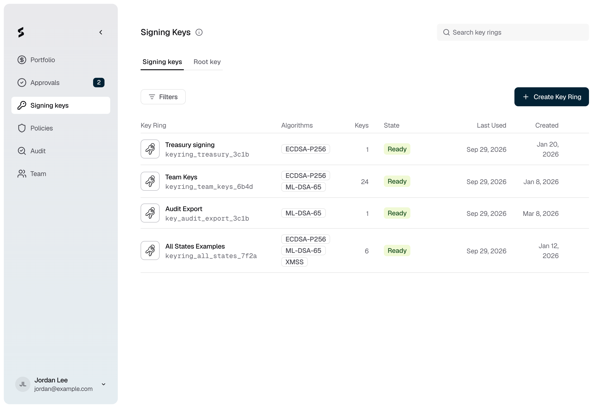

Signing keys is Strongpoint's key management service (KMS). It holds your signing keys with a provider such as AWS KMS, and signs payloads only after your approvers agree. The keys behind your custody accounts live here too.

<Frame caption="Figure 1: Signing keys lists your key rings.">
  
</Frame>

## Key rings, keys and versions

- **Key ring.** A key ring is a stable signing identity. Your systems sign against the key ring, so you can add or rotate keys without changing what they point at. Each key ring gets an ID that starts with `kr_`.
- **Key.** A key ring holds one or more keys, each with its own algorithm and provider. When the key ring signs, every ready key signs, so you get one signature per key. This lets a key ring sign with a classical and a post-quantum algorithm side by side.
- **Key version.** Each key starts at version 1 (**v1**). [Rotating](/kms/rotate-key) a key adds a version and makes it current. Older versions stop signing.

A key ring can back one custody account. That key ring signs the account's transactions only, so you can't use it to [sign a payload](/kms/sign-payload). See [Portfolio](/portfolio/overview).

## Who can use Signing keys

**Signing keys** appears in the sidebar for Owners and Admins. They can create key rings, add, rotate, disable and delete keys, and request signatures. The **Root key** tab holds your organization's PEAK root key, which an Owner sets up. See [PEAK key rings](/kms/create-key-ring#peak-key-rings).

{/* TK: the backend also lets Signers read keys and sign (rs/authz/cedar/policies.cedar, signer-kms-read-sign), but the console hides Signing keys from them. Confirm with product which is intended. */}

## What needs approval

| Action | Approval |
|---|---|
| Sign a payload | Every enrolled member must approve, within 24 hours |
| Create a key ring, add, rotate, disable, enable or delete a key | None. The action applies as soon as you confirm it |
| Create a PEAK key ring | Its key holders approve on their iPhones |
| Add a key to a PEAK key ring | An approval request, decided by your **Add key** policy |

{/* TK: the Policies page lists Add key, Rotate key and Delete key as editable policies, and says "Sign payload: No approval needed". The backend ignores those policies except for PEAK Add key (proto/omega/v1/keys.proto, ENG-2251 and ENG-2213), and always requires unanimous approval for signing (rs/kms/src/domain/sign/raise.rs). Ask product to align the console copy. */}

## Tasks

<CardGroup cols={3}>
  <Card title="Create a key ring" icon="key" href="/kms/create-key-ring">
    Set up a signing identity and its first keys.
  </Card>
  <Card title="Add a key" icon="plus" href="/kms/add-key">
    Add another algorithm or provider to a key ring.
  </Card>
  <Card title="Sign a payload" icon="signature" href="/kms/sign-payload">
    Sign a message with every key in a key ring.
  </Card>
  <Card title="Rotate a key" icon="rotate" href="/kms/rotate-key">
    Replace a key's material while keeping its ID.
  </Card>
  <Card title="Disable or delete a key" icon="ban" href="/kms/disable-or-delete-key">
    Pause signing, or remove a key for good.
  </Card>
</CardGroup>

## Reference

- [Algorithms and providers](/kms/algorithms-and-providers): what each algorithm and provider supports.
- [Key states](/kms/key-states): what each state means.
