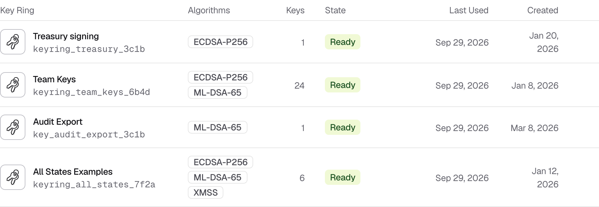

Strongpoint relies on a key management service (KMS) to hold the keys behind your digital assets. **Signing keys** shows those keys and their properties, such as the algorithm each one signs with and whether it is post-quantum.

The keys are modular, so Strongpoint can move your assets to a new algorithm quickly. Those changes start from [Portfolio](/portfolio/overview), not from here. In **Signing keys**, you can view your keys and [sign a payload](/kms/sign-payload).

<Frame caption="Figure 1: Each key ring and the algorithms its keys use.">
  
</Frame>

## How keys map to your portfolio

- **Key ring.** Strongpoint creates a key ring for each account when you [create the account](/portfolio/manage-accounts#creating-an-account). One key ring backs one account.
- **Key.** Each key in a key ring backs one wallet in that account, and the addresses of that wallet.
- **Key version.** A key's current version is the one that signs.

{/* TK: Tyler (Nov 2026) says key rings are created automatically with each account and that users don't create key rings or add, rotate, disable or delete keys. The production console still offers Create Key Ring, Add Key, Rotate and the disable and delete actions, and Add account asks you to pick a PEAK key ring you set up first. */}

## Root key

The **Root key** tab holds your organization's root key. No one holds it whole: each holder keeps a share on their iPhone, and using it needs their approval. Owners and Admins can see this tab, and an Owner sets the root key up.

{/* TK: link to the PEAK setup page once it is written. */}

## Tasks

<CardGroup cols={2}>
  <Card title="Sign a payload" icon="signature" href="/kms/sign-payload">
    Sign a message with a key ring, after your root key holders approve.
  </Card>
</CardGroup>

## Reference

- [Algorithms and providers](/kms/algorithms-and-providers): the signing algorithms Strongpoint uses.
- [Key states](/kms/key-states): what each state means.
