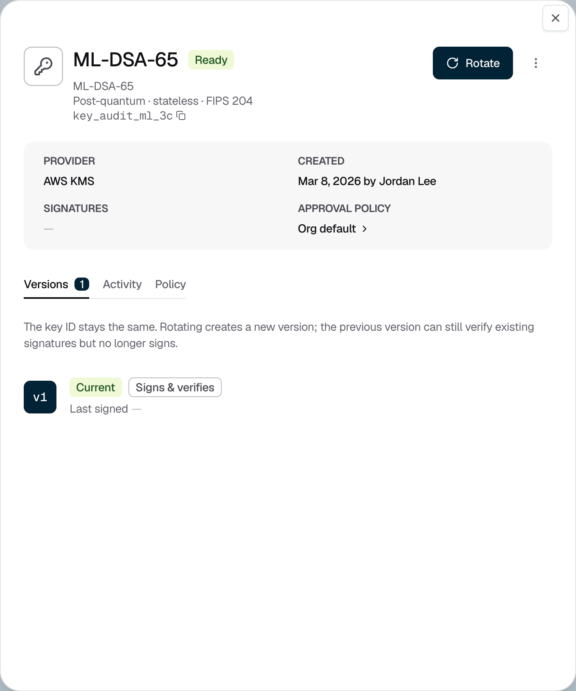
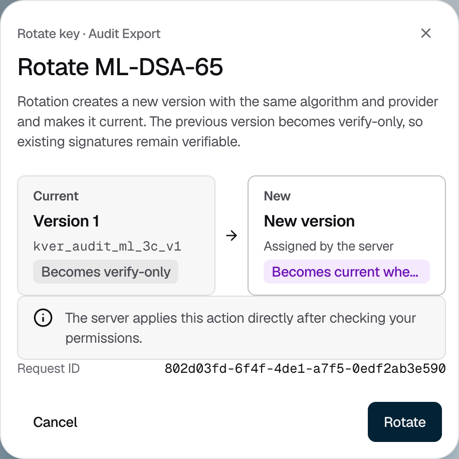

<Info>Requires the Owner or Admin role. Rotation needs no approval.</Info>

Rotate a key to replace its key material. The key ID stays the same, so nothing that points at the key or its key ring changes.

## Rotating a key

<Steps>
  <Step title="Open the key">
    Go to **Signing keys**, open the key ring, and click the key. Its **Versions** tab lists every version.

    <Frame caption="Figure 1: A key's details and its version history.">
      
    </Frame>
  </Step>
  <Step title="Rotate it">
    Click **Rotate**, check the current and new versions, then click **Rotate** to confirm.

    <Frame caption="Figure 2: The new version becomes current when it is ready.">
      
    </Frame>

    The console shows "Key rotated" once the new version is ready. The new version has the same algorithm and provider. The previous version stops signing and shows **Verify only**. Until the new version is ready, the previous one keeps signing.
  </Step>
</Steps>

## If it does not work

| What you see | What to do |
|---|---|
| "Wait for the provisioning version to finish before continuing." | A version is still being created. Try again in a moment. |
| "PEAK keys cannot be rotated from the console yet." | Rotation of PEAK keys is not available yet. |
| "Rotation status could not be confirmed." | Refresh the key and check its versions. Don't rotate again until you have checked. |
| "Key rotation needs attention" | The new version could not be created. The key stays on its previous version. Try again, or contact [Strongpoint support](mailto:support@strongpoint.projecteleven.com). |
