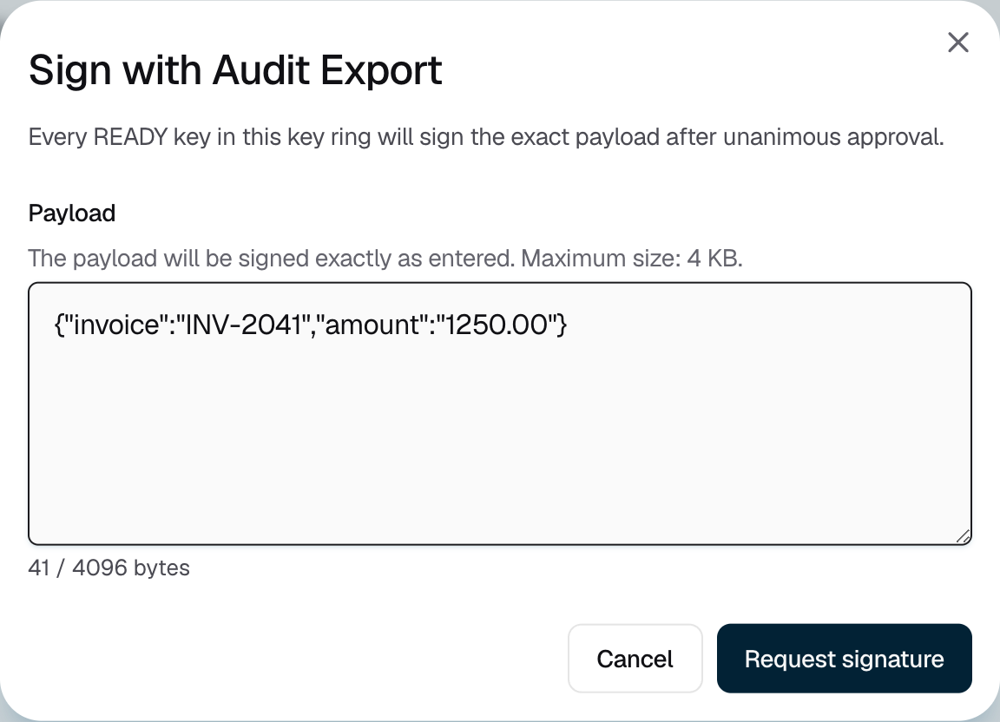

Signing a payload is the one action you take in **Signing keys**. Strongpoint signs exactly what you enter, so check the payload carefully before you request a signature.

<Info>Only root key holders can sign a payload. Each signature needs approval from your root key holders, within 24 hours.</Info>

{/* TK: Tyler (Nov 2026) says only root key holders can sign, and that signing needs root key approvals. In the code, Owners and Admins can sign (Cedar signActions), every enrolled member must approve (rs/kms/src/domain/sign/raise.rs, unanimous), the console says "Awaiting unanimous approval", PEAK key rings can't sign from the console, and a key ring that backs an account is refused. */}

## Signing a payload

<Steps>
  <Step title="Open the signing dialog">
    Go to **Signing keys** and open the key ring. Click the **⋮** menu, then **Sign payload**.
  </Step>
  <Step title="Enter the payload">
    Under **Payload**, enter the exact text to sign, up to 4 KB. Strongpoint signs it byte for byte, as UTF-8 text. Then click **Request signature**.

    <Frame caption="Figure 1: Every ready key in the key ring signs the payload.">
      
    </Frame>
  </Step>
  <Step title="Wait for approval">
    Your root key holders approve the request on their iPhones. Strongpoint signs as soon as the last approval arrives, even if you close the dialog.
  </Step>
  <Step title="Copy the signatures">
    The dialog shows "Payload signed", with one signature per key. Each shows its **Key version**, **Algorithm** and **Hex signature**. Click **Copy** to copy each one.
  </Step>
</Steps>

<Warning>Strongpoint doesn't store signatures. Copy them before you leave the page. They are cleared when your session ends.</Warning>

## Signature format

| Algorithm | What Strongpoint signs | Signature format |
|---|---|---|
| ECDSA-P256, ECDSA-secp256k1 | The SHA-256 hash of the payload | DER-encoded ECDSA signature |
| ML-DSA-65, ML-DSA-87 | The payload itself | Raw ML-DSA signature (FIPS 204) |

{/* TK: ECDSA-secp256k1 signatures are not normalized to low-S. Confirm with product whether to document this. */}

## If it does not work

| What you see | What to do |
|---|---|
| "The payload is too large. Maximum size: 4 KB." | Shorten the payload to 4,096 bytes or fewer. |
| **Sign payload** is greyed out, with "Signing is paused while this key ring is disabled." | The key ring's account is archived. Unarchive it from [Manage accounts](/portfolio/manage-accounts) to sign with it. |
| "Finish the active signing operation for … before starting another." | Wait for your open signing request to finish. You can run one at a time. |
| "Signing was not completed" | An approver rejected the request, it was cancelled, or it expired. Request a new signature. |
| "Signing status unknown" | Don't submit it again. Check the request on the key ring's **Approvals** tab. |
| "You are not permitted to sign with this key ring." | Ask a root key holder to sign. |
