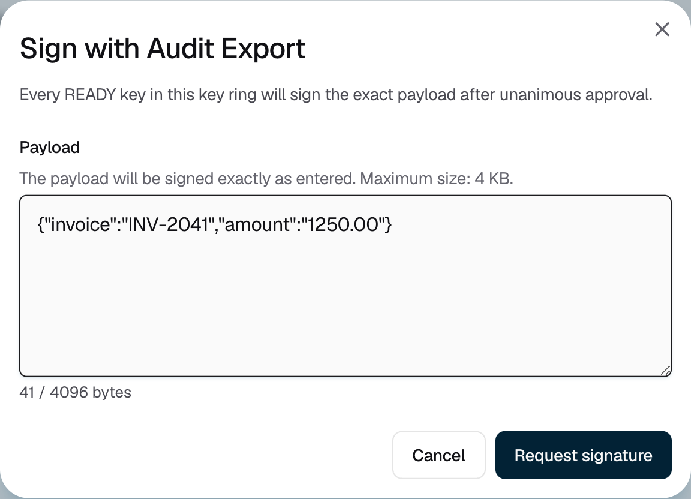

<Info>Requires the Owner or Admin role. Every enrolled member of your organization must approve each signature, within 24 hours.</Info>

## Signing a payload

<Steps>
  <Step title="Open the signing dialog">
    Go to **Signing keys** and open the key ring. Click the **⋮** menu, then **Sign payload**.
  </Step>
  <Step title="Enter the payload">
    Under **Payload**, enter the exact text to sign, up to 4 KB. Strongpoint signs it byte for byte, as UTF-8 text. Then click **Request signature**.

    <Frame caption="Figure 1: Every ready key in the key ring signs the payload.">
      
    </Frame>
  </Step>
  <Step title="Wait for approval">
    The dialog shows "Awaiting unanimous approval". Every enrolled member approves the request on their iPhone. Strongpoint signs as soon as the last approval arrives, even if you close the dialog.
  </Step>
  <Step title="Copy the signatures">
    The dialog shows "Payload signed", with one signature per key. Each shows its **Key version**, **Algorithm** and **Hex signature**. Click **Copy** to copy each one.
  </Step>
</Steps>

<Warning>Strongpoint doesn't store signatures. Copy them before you leave the page. They are cleared when your session ends.</Warning>

## Signature format

| Algorithm | What Strongpoint signs | Signature format |
|---|---|---|
| ECDSA-P256, ECDSA-secp256k1 | The SHA-256 hash of the payload | DER-encoded ECDSA signature |
| ML-DSA-65, ML-DSA-87 | The payload itself | Raw ML-DSA signature (FIPS 204) |

{/* TK: ECDSA-secp256k1 signatures are not normalized to low-S. Confirm with product whether to document this. */}

## If it does not work

| What you see | What to do |
|---|---|
| "The payload is too large. Maximum size: 4 KB." | Shorten the payload to 4,096 bytes or fewer. |
| **Sign payload** is greyed out, with "Signing is paused while this key ring is disabled." | [Enable the key ring](/kms/disable-or-delete-key), then try again. |
| "Finish the active signing operation for … before starting another." | Wait for your open signing request to finish. You can run one at a time. |
| "Signing cannot start because approvers are missing or another signing requirement is not met." | Check that your organization has a member with an enrolled iPhone. The key ring must not back a custody account. |
| "Signing was not completed" | An approver rejected the request, it was cancelled, or it expired. Request a new signature. |
| "Signing status unknown" | Don't submit it again. Check the request on the key ring's **Approvals** tab. |
| "PEAK key rings do not support signing from the console yet." | Sign with your PEAK devices instead. |
