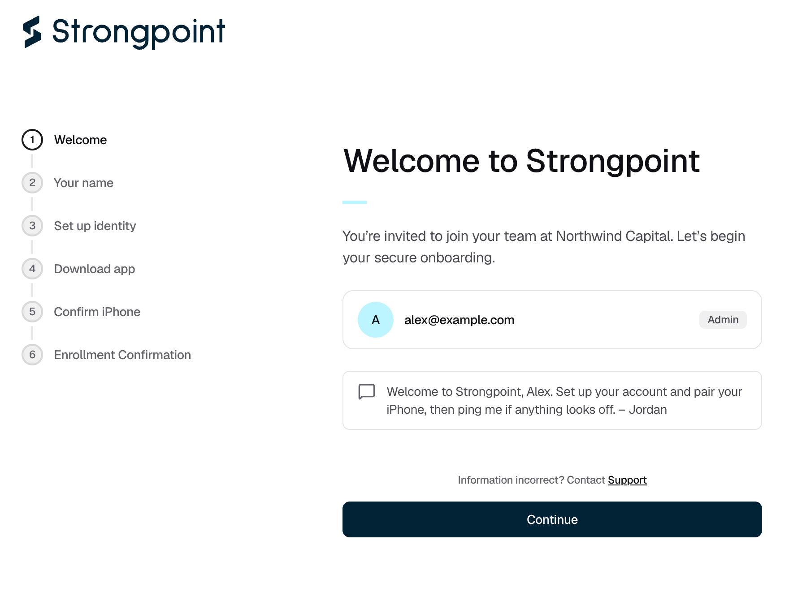
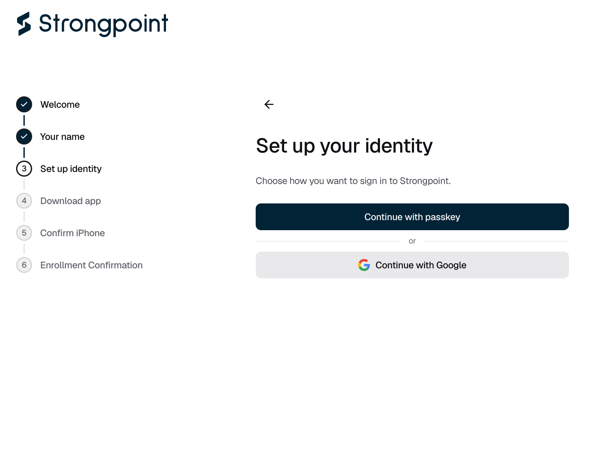

## Accepting your invitation

<Steps>
  <Step title="Open the invitation">
    On the computer you will use for Strongpoint, click the link in the invitation email. The console opens on **Welcome to Strongpoint**.
  </Step>
  <Step title="Check your details">
    Check your organization, email, and role, then click **Continue**. If anything is wrong, click **Support** instead.

    <Frame caption="Figure 1: The welcome screen shows your organization, your email, and your role, plus any message from the person who invited you.">
      
    </Frame>
  </Step>
  <Step title="Enter your name">
    Enter your full name and click **Continue**.
  </Step>
  <Step title="Choose how you log in">
    On **Set up your identity**, click **Continue with passkey** or **Continue with Google**. You use the same method every time you log in.

    - **Passkey.** Follow your browser's prompt. If you create a new passkey, save it to a password manager your iPhone can access. If you already have a Strongpoint passkey from another organization, use that one.
    - **Google.** Choose your work Google account.

    <Frame caption="Figure 2: Choose a passkey or your Google account.">
      
    </Frame>

    The console then asks you to install the Strongpoint Authenticator. Continue with [Enroll your iPhone](/onboarding/enroll-iphone).
  </Step>
</Steps>

## If it does not work

| What you see | What to do |
|---|---|
| "Invitation already accepted" | You have already joined. [Log in](/onboarding/log-in). |
| "Invitation expired" or "Invitation revoked" | Ask the person who invited you for a new invitation. |
| "Invitation not found" or "Invitation link incomplete" | The link was cut off. Copy the full link from the email into your browser. |
| "We could not load your invitation" | Click the link in the email again. If it still fails, ask for a new invitation. |
| "This browser does not support passkeys" | Open the link in a current version of Chrome or Safari. |
| "Passkey setup was cancelled" or "Passkey setup timed out" | Click **Try again**. Your invitation is still valid. |
| "Google sign-in needs storage this browser is blocking" | Allow the site to store data in your browser settings and reload, or use a passkey instead. |
| "Your passkey was verified, but we could not confirm that the invitation was accepted" | Click **Try again**. If it keeps happening, contact [Strongpoint support](mailto:support@strongpoint.projecteleven.com). |
| "Invitation accepted", with "Wait for your organization admin to start device enrollment" | You already use Strongpoint with another organization. Ask an Owner or Admin to [send you a device enrollment](/organisation/send-device-enrollment). |
| No invitation email | Check your spam folder, then ask the person who invited you to check it was sent. |
