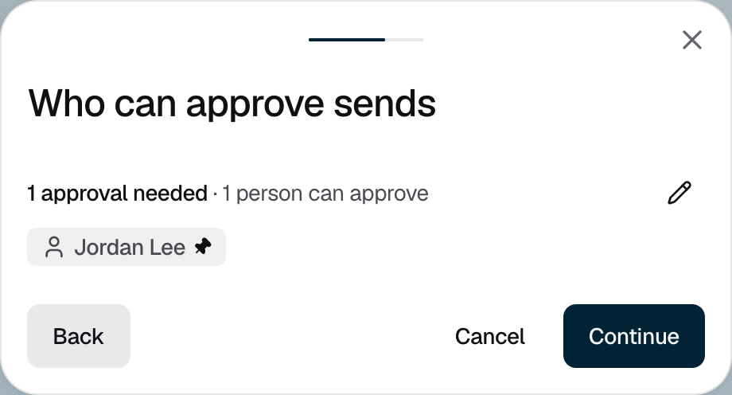

<Info>Requires the Owner or Admin role.</Info>

<Info>Requires approval from your organization's root key holders.</Info>

An account holds your assets in one or more wallets. When you create it, you choose who approves sending funds out of it. Adding wallets and archiving follow your organization's [policies](/policies-and-approvals/policies).

## Creating an account

<Steps>
  <Step title="Start a new account">
    Go to **Portfolio** and click **Add account**.
  </Step>
  <Step title="Name it and choose its assets">
    Enter an **Account name**, for example "Treasury". Under **Select assets to manage**, choose the assets it will hold. Then click **Continue**. Once the account is approved, Strongpoint provisions its keys. The people approved to send from the account hold them.
  </Step>
  <Step title="Choose who approves sends">
    **Who can approve sends** starts with your organization default. To keep it, click **Continue**. To change it, click the pencil, choose approvers and **Approvals needed**, then click **Continue**.

    <Frame caption="Figure 1: Sends start with your organization default policy.">
      
    </Frame>
  </Step>
  <Step title="Create the account">
    On **Review account**, check the name, assets and approvers, then click **Create account**. The console shows "Approval requested": Strongpoint creates one wallet for each network you chose, and each wallet waits for a **Create Wallet** approval. Once approved, you can [receive funds](/portfolio/receive-funds) into it.
  </Step>
</Steps>

{/* TK: Tyler (Nov 2026) says Strongpoint creates the account's key ring automatically, and that root key holders and the account's operators approve each new account. In the production console, Add account asks you to pick a PEAK key ring you have already set up ("Keep the keys on a PEAK key ring you have already set up. Set up new ones on the Keys page."), and creating the account raises only Create Wallet approvals. */}

## If it does not work

| What you see | What to do |
|---|---|
| "An account with this name already exists." | Choose another name. |
| "Networks are not available right now. Try again in a moment." | The asset list did not load. Wait a moment and try again. |
| "Could not create the account." | Click **Create account** again. If it still fails, contact [Strongpoint support](mailto:support@strongpoint.projecteleven.com). |
