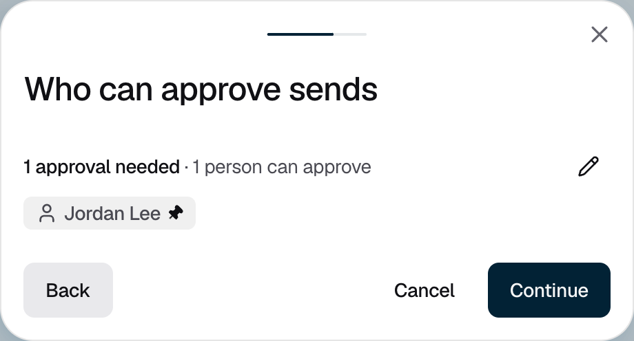

<Info>Requires the Owner or Admin role. Creating the account needs no approval. Each wallet it starts with does.</Info>

An account holds your assets in one or more wallets. When you create it, you choose who approves sending funds out of it. Adding wallets and archiving follow your organization's [policies](/policies-and-approvals/policies).

## Creating an account

<Steps>
  <Step title="Start a new account">
    Go to **Portfolio** and click **Add account**.
  </Step>
  <Step title="Name it and choose its key ring and assets">
    Enter an **Account name**, for example "Treasury". Under **Key ring**, keep **New AWS KMS key ring**, or choose a [PEAK key ring](/kms/create-key-ring#peak-key-rings) you have already set up. Under **Select assets to manage**, choose the assets it will hold. Then click **Continue**.
  </Step>
  <Step title="Choose who approves sends">
    **Who can approve sends** starts with your organization default. To keep it, click **Continue**. To change it, click the pencil, choose approvers and **Approvals needed**, then click **Continue**.

    <Frame caption="Figure 1: Sends start with your organization default policy.">
      
    </Frame>
  </Step>
  <Step title="Create the account">
    On **Review account**, check the name, key ring, assets and approvers, then click **Create account**. The console shows "Approval requested": Strongpoint creates one wallet for each network you chose, and each wallet waits for a **Create Wallet** approval. Once approved, you can [receive funds](/portfolio/receive-funds) into it.
  </Step>
</Steps>

## If it does not work

| What you see | What to do |
|---|---|
| "An account with this name already exists." | Choose another name. |
| "This key ring cannot back a new account. It may already back another one." | Choose **New AWS KMS key ring**, or another PEAK key ring. |
| "Waiting for the PEAK root of this key ring to be established." | Wait until the key ring's holders have joined on their iPhones. |
| "Networks are not available right now. Try again in a moment." | The asset list did not load. Wait a moment and try again. |
| "Could not create the account." | Click **Create account** again. If it still fails, contact [Strongpoint support](mailto:support@strongpoint.projecteleven.com). |
