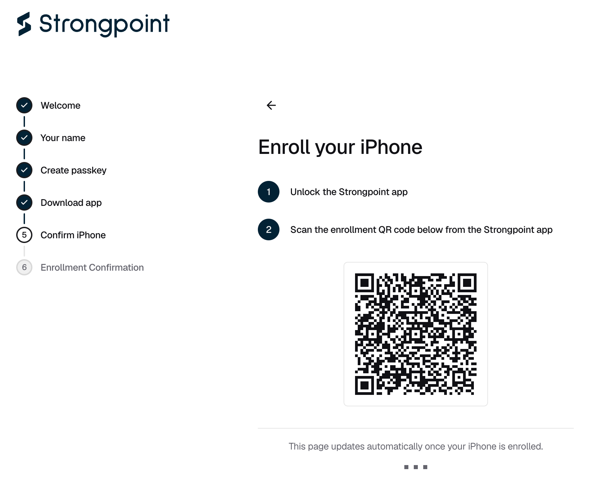
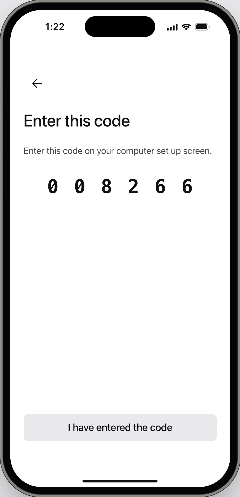

<Note>The Strongpoint Authenticator runs on iPhone with iOS 26 or later. The console and the App Store call it "Strongpoint".</Note>

## Enrolling your iPhone

<Steps>
  <Step title="Install the app">
    On **Download the Strongpoint app**, scan the QR code with your iPhone camera and install the app. The app is installed from this link, so it does not appear in App Store search. Then click **I have the app**.
  </Step>
  <Step title="Scan the enrollment QR code">
    On your iPhone, unlock the Strongpoint Authenticator, tap **Open Camera**, and scan the QR code on **Enroll your iPhone**.

    <Frame caption="Figure 1: Scan this code with Open Camera inside the Strongpoint Authenticator.">
      
    </Frame>
  </Step>
  <Step title="Confirm on your iPhone">
    In the app, check the enrollment details and confirm with Face ID or Touch ID. The app then shows a six-digit code.

    <Frame caption="Figure 2: The app shows the code to type into the console.">
      
    </Frame>
  </Step>
  <Step title="Enter the code in the console">
    <Warning>You get one try at the code. A wrong code cancels the enrollment, and you start again with a new QR code.</Warning>

    On **Confirm your iPhone**, type the code and click **Confirm**. Then tap **I have entered the code** in the app.
  </Step>
  <Step title="Wait for approval">
    On **Awaiting Device Enrollment Approval**, an approver in your organization approves your iPhone in their Strongpoint Authenticator. If your organization has no other approvers yet, Strongpoint approves it. The page updates when the approval arrives.
  </Step>
  <Step title="Log in">
    On **You're all set**, click **Log in to Strongpoint**.
  </Step>
</Steps>

## If it does not work

| What you see | What to do |
|---|---|
| "The download QR is unavailable" | Ask [Strongpoint support](mailto:support@strongpoint.projecteleven.com) for the App Store link. |
| "Pairing failed - incorrect 6-digit code" | Click **Get a new QR code** and start again from step 2. |
| The app does not accept the QR code | Click **Get a new QR code** and scan the new one. |
| "We could not start pairing", with "You already have a paired device for this organization" | This iPhone is already enrolled. Click **Log in**. |
| "We could not start pairing", with "Request your team to issue you an enrollment" | Ask an Owner or Admin to [send you a device enrollment](/organisation/send-device-enrollment). |
| "Awaiting Device Enrollment Approval" does not change | Ask an approver to [approve your iPhone](/policies-and-approvals/approve-request) in the Strongpoint Authenticator. |
| "Your session expired. Please log in again." | More than 30 minutes passed since you set up your passkey or Google login. [Log in](/onboarding/log-in), then click **Enroll Device**. |

{/* TK: link the App Store listing once the production URL is set (STRONGPOINT_PUBLIC_APP_STORE_URL). */}
