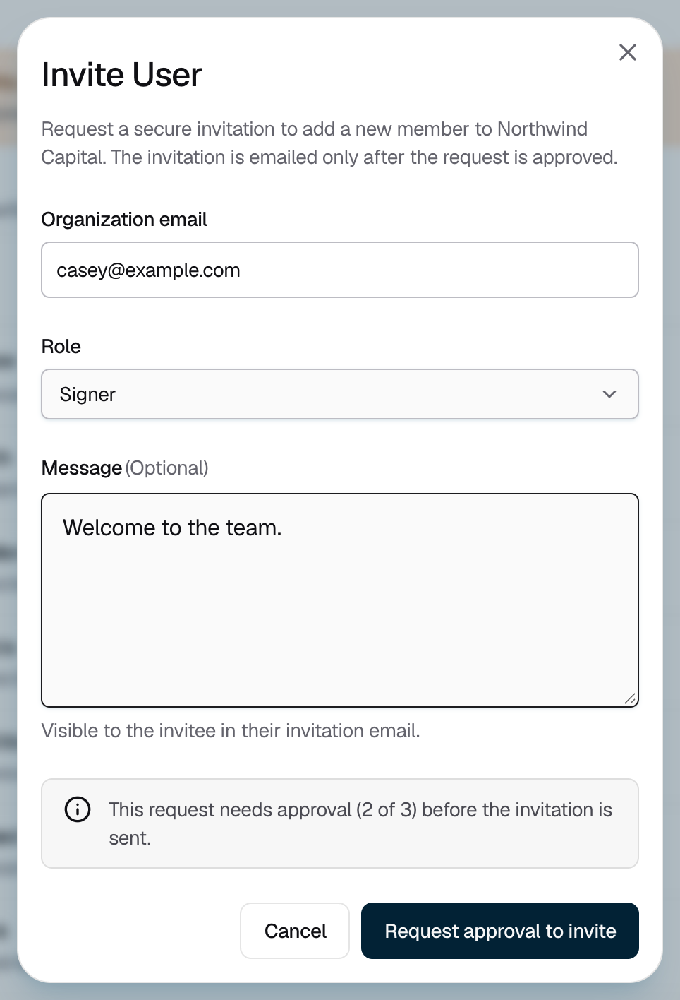

<Info>Requires the Owner or Admin role, and an **Add user** policy with enough approvers. See [Change a policy](/policies-and-approvals/change-policy).</Info>

## Inviting a teammate

<Steps>
  <Step title="Open the invite form">
    Go to **Team** and click **Invite User**.
  </Step>
  <Step title="Fill in the details">
    Enter your teammate's **Organization email** and choose a **Role**. You can add a **Message**, which appears in their invitation email.

    <Frame caption="Figure 1: The note above the buttons shows how many approvals the invitation needs.">
      
    </Frame>
  </Step>
  <Step title="Request approval">
    Check how many approvals the request needs, then click **Request approval to invite**.
  </Step>
  <Step title="Get it approved">
    Ask your approvers to approve the request in the Strongpoint Authenticator. Strongpoint emails your teammate once enough of them approve. If the request shows **Expired**, start it again. For how long approvers have, see [Request statuses](/policies-and-approvals/request-statuses#time-windows).
  </Step>
</Steps>

## After you invite

Your teammate has 24 hours to accept the invitation once it is sent. They follow [Accept your invitation](/onboarding/accept-invite) and [Enroll your iPhone](/onboarding/enroll-iphone).

Track each invitation under **Team > Invitations**. Its status moves through **Invitation approval**, **Invite sent**, **Awaiting enrollment**, **Confirm device**, and **Enrollment approval**. At **Enrollment approval**, approvers approve your teammate's iPhone.

## Roles

| Role | Can do |
|---|---|
| Owner | Full organization control, including inviting and assigning other Owners. |
| Admin | The same as an Owner, except inviting or assigning Owners. |
| Signer | Read keys and sign. Cannot manage users, policies, or organization settings. |
| Auditor | Read-only access to keys, approvals, and audit history. |

## If it does not work

| What you see | What to do |
|---|---|
| "Invitation approval is unavailable" | Your organization has no invitation rule, or not enough approvers qualify for it. An Owner or Admin must fix the rule first. |
| "Invitation status is unknown" | Check **Approvals** and **Team** for an existing request before you try again. |
| "Too many invitation attempts" | Wait a moment, then try again. |
| Your teammate got no email | Check that the status shows **Invite sent** and the address is right. Ask them to check spam. |
| "Invitation expired" | Your teammate did not accept within 24 hours. Send a new invitation. |
| Your teammate joined but has no enrolled iPhone | [Send them a device enrollment](/organisation/send-device-enrollment). |
