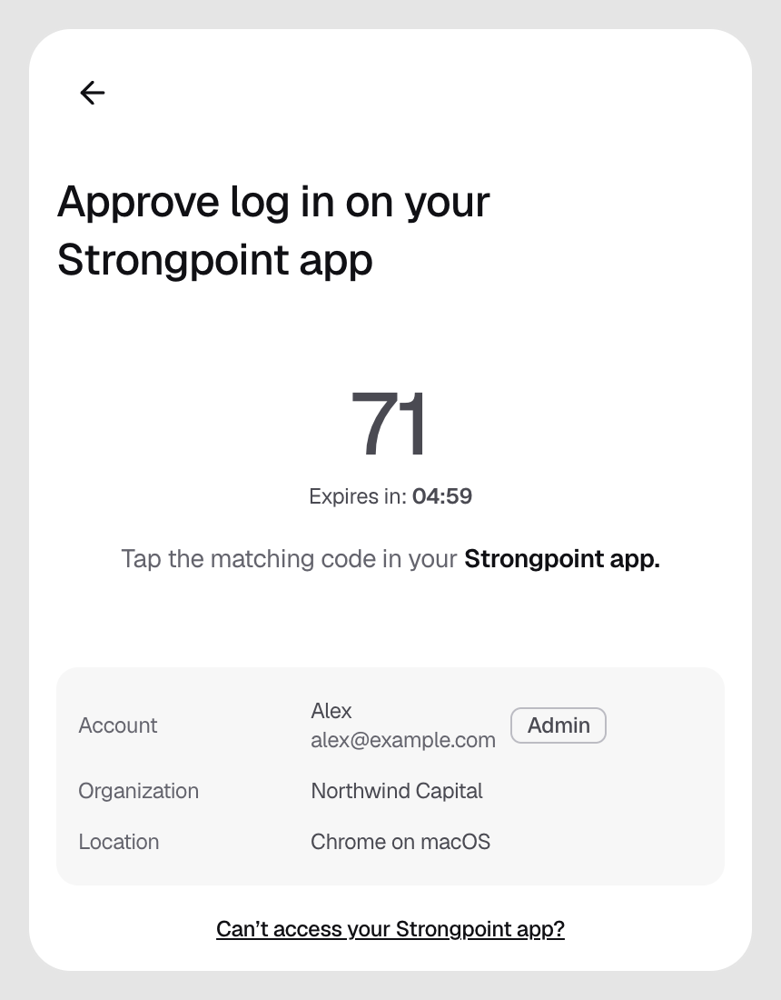
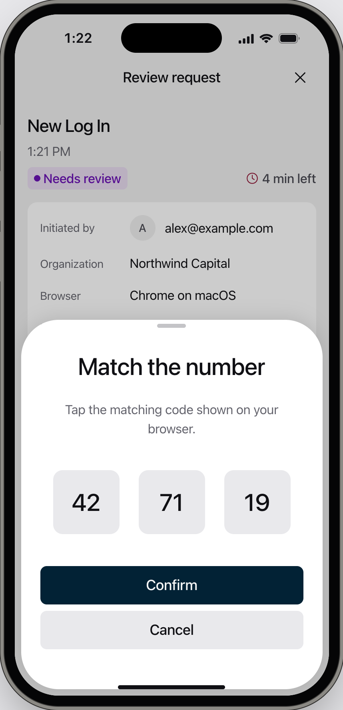

## Logging in

<Steps>
  <Step title="Enter your email">
    Go to [strongpoint.projecteleven.com](https://strongpoint.projecteleven.com), enter your work email, and click **Continue with Passkey** or **Continue with Google**.
  </Step>
  <Step title="Choose your organization">
    If you belong to more than one organization, choose the one to open.
  </Step>
  <Step title="Note the number">
    The console shows a two-digit number. You have 5 minutes to confirm it on your iPhone.

    <Frame caption="Figure 1: The console shows the number to look for on your iPhone.">
      
    </Frame>
  </Step>
  <Step title="Confirm on your iPhone">
    Unlock the Strongpoint Authenticator with Face ID or Touch ID and open the **New Log In** request. Tap the number that matches the console, tap **Confirm**, and confirm with Face ID or Touch ID. The console opens.

    <Frame caption="Figure 2: Tap the same number as the console. A wrong number rejects the login.">
      
    </Frame>
  </Step>
</Steps>

## If it does not work

| What you see | What to do |
|---|---|
| "Log in rejected", with "This request was rejected" | You tapped the wrong number, or rejected the login on your iPhone. Log in again. |
| "Log in rejected", with "does not have an active enrolled device" | Click **Enroll Device** and follow [Enroll your iPhone](/onboarding/enroll-iphone). |
| "Request time out" | You did not confirm within 5 minutes. Log in again. |
| "No active organization" | Your membership is not active yet. Ask an Owner or Admin to check it. |
| "Decision not recorded" | Log in again to start a new request. |
| No notification on your iPhone | Open the Strongpoint Authenticator anyway. The request is there. |
| You no longer have your enrolled iPhone | Ask an Owner or Admin to [send you a device enrollment](/organisation/send-device-enrollment) for your new iPhone. The **Can't access your Strongpoint app?** link on the login page leads to the same enrollment. |
