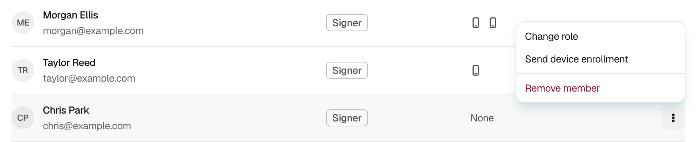
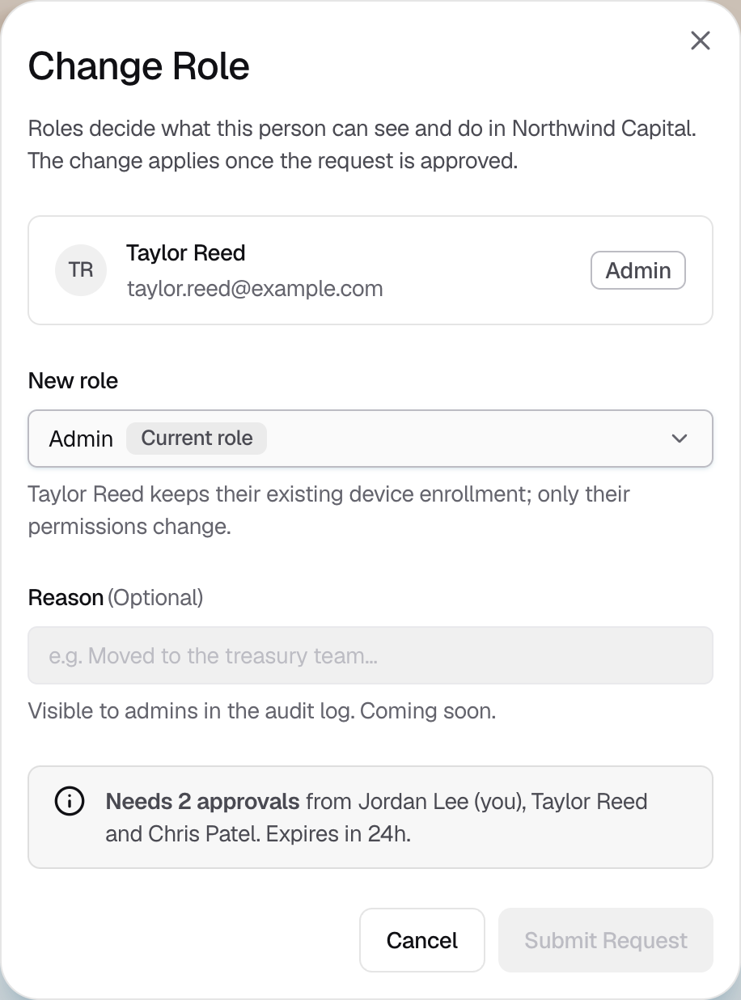

<Info>Requires the Owner or Admin role. Each change is an approval request, decided by your **Change role** policy. Only an Owner can change an Owner's role or make someone an Owner.</Info>

## Changing a role

<Steps>
  <Step title="Open the member's menu">
    Go to **Team** and stay on **Members**. Click the **…** button on the member's row, then **Change role**.

    <Frame caption="Figure 1: The member's menu on the Team page.">
      
    </Frame>
  </Step>
  <Step title="Choose the new role">
    Under **New role**, choose the role. Each option says what the role can do, and the member's current role is marked **Current role**. The member keeps their enrolled iPhone. Only their permissions change. See [Roles and permissions](/organisation/roles-and-permissions).

    <Frame caption="Figure 2: The dialog shows who must approve the change.">
      
    </Frame>
  </Step>
  <Step title="Request the change">
    Check how many approvals the request needs, then click **Submit Request**. The console shows "Request submitted". The member moves to the new role once enough approvers approve.
  </Step>
</Steps>

While the request is open, the member's menu shows **Withdraw role change**, which you can use to cancel it.

## If it does not work

| What you see | What to do |
|---|---|
| **Change role** is greyed out, with "A role change is already waiting for approval." | Wait for the open request to finish, or withdraw it. |
| "Role change could not be requested" | Your role can't make this change. Only an Owner can change an Owner's role. |
| "This role change cannot proceed" | The member may be inactive, or they may be the last Owner or Admin. Every organization needs at least one of each. |
| "Role change already requested" | A request for this member is already open. Check **Approvals**. |
| "Role-change status is unknown" | Check **Approvals** and **Team** for an existing request before you try again. |
