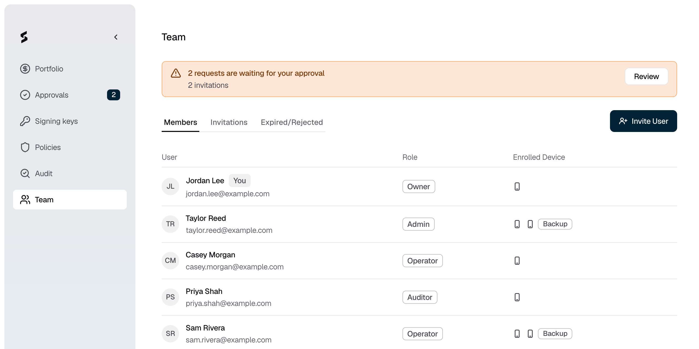

The **Team** page shows who belongs to your organization. For each member, you see their role and the iPhones they have enrolled. Invitations that are still open appear on their own tab.

<Frame caption="Figure 1: Each member's role and enrolled iPhones. Backup marks a backup iPhone.">
  
</Frame>

## What's on the Team page

- **Members** lists everyone in your organization, with their role and enrolled devices. Click a member to see their devices.
- **Invitations** lists invitations that are waiting to be approved or accepted.
- **Expired/Rejected** lists invitations that ran out or weren't approved.

Owners and Admins invite people, send device enrollments, revoke devices, change roles and remove members. Every change to who is in your organization, or to their role, is an approval request.

## Tasks

<CardGroup cols={2}>
  <Card title="Invite your team" icon="user-plus" href="/onboarding/invite-users">
    Invite someone and choose their role.
  </Card>
  <Card title="Send a device enrollment" icon="mobile" href="/organisation/send-device-enrollment">
    Let a member enroll a first or new iPhone.
  </Card>
  <Card title="Revoke a device" icon="ban" href="/organisation/revoke-device">
    Stop a lost or replaced iPhone from approving.
  </Card>
  <Card title="Change a member's role" icon="user-gear" href="/organisation/change-role">
    Give a member a different role.
  </Card>
</CardGroup>

## Reference

- [Roles and permissions](/organisation/roles-and-permissions): what each role can see and do.
