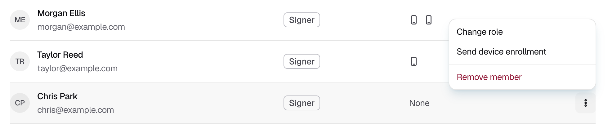

<Info>Requires the Owner or Admin role.</Info>

## Sending a device enrollment

<Steps>
  <Step title="Find the member">
    Go to **Team** and find the member in the list.
  </Step>
  <Step title="Send the enrollment">
    At the end of the member's row, click **⋮** and choose **Send device enrollment**.

    <Frame caption="Figure 1: The menu on a member's row. A member with no enrolled iPhone shows None.">
      
    </Frame>
  </Step>
  <Step title="Get it approved">
    Ask your approvers to approve the request. Once they do, Strongpoint emails the member a link. If the request shows **Expired**, send the enrollment again.
  </Step>
  <Step title="The member enrolls">
    The member opens the link on a computer and logs in. They then follow [Enroll your iPhone](/onboarding/enroll-iphone) from **Scan the enrollment QR code**, including typing the six-digit code. An approver then approves their iPhone.
  </Step>
</Steps>

## If it does not work

| What you see | What to do |
|---|---|
| The member got no email | Check that the request was approved in **Approvals**. Ask them to check spam. |
| The member sees "Request your team to issue you an enrollment" | Their enrollment was used or has expired. Send a new device enrollment. |
| "Pairing failed - incorrect 6-digit code" | Send a new device enrollment. Each enrollment allows one try at the code. |
