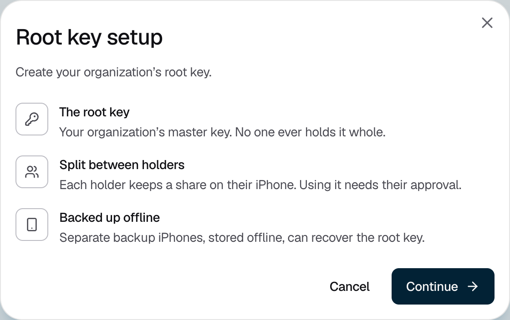
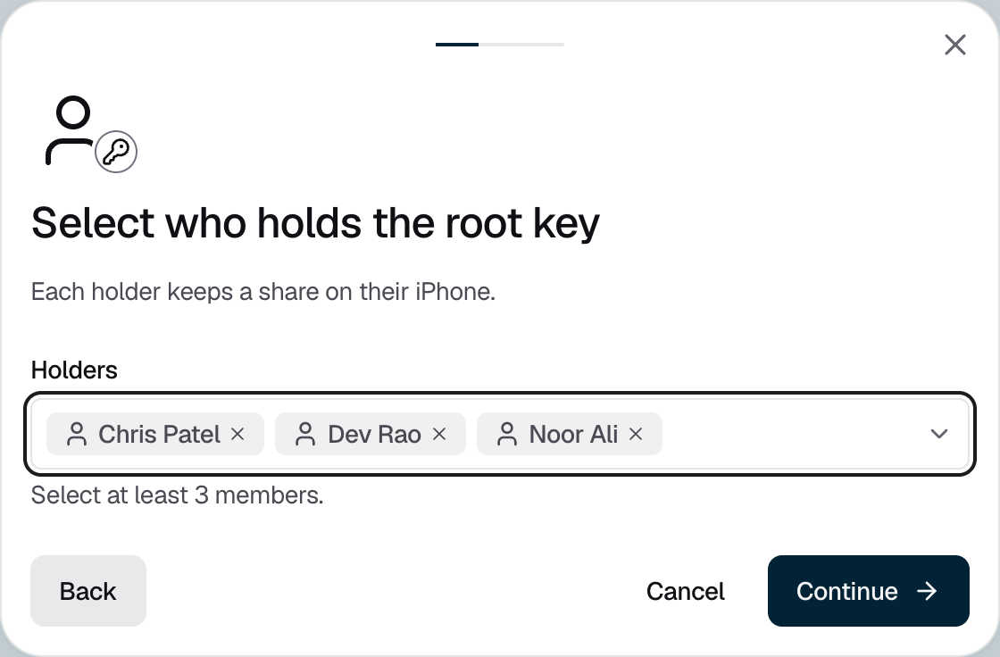
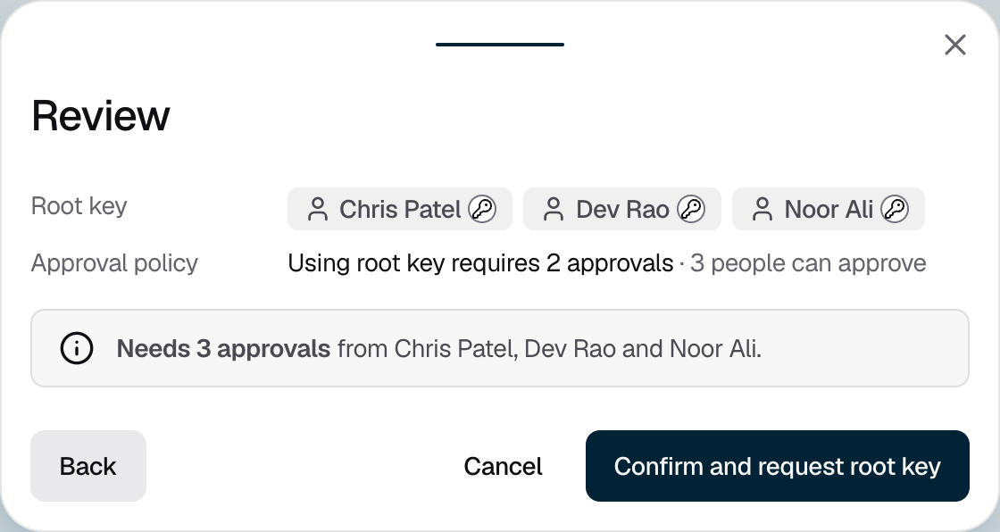

<Info>Requires the Owner role. You need at least 3 members with an enrolled iPhone, you included.</Info>

## Setting up the root key

<Steps>
  <Step title="Start the setup">
    Go to **Signing keys**, open the **Root key** tab, and click **Set up root key**. Read the summary, then click **Continue**.

    <Frame caption="Figure 1: The root key is split between holders and backed up offline.">
      
    </Frame>
  </Step>
  <Step title="Choose the holders">
    Under **Holders**, pick between 3 and 30 members. Each holder keeps a share on their iPhone. Members without an enrolled iPhone show **No iPhone** and can't be picked. Then click **Continue**.

    <Frame caption="Figure 2: Three holders, each with an enrolled iPhone.">
      
    </Frame>
  </Step>
  <Step title="Choose how many must approve">
    Under **Approvals needed**, choose how many holders must approve each use of the root key. The default is a majority, and the minimum is 2. Then click **Continue**.
  </Step>
  <Step title="Review and request">
    Check the holders and the approval policy, then click **Confirm and request root key**.

    <Frame caption="Figure 3: Every holder approves the request before the key is created.">
      
    </Frame>
  </Step>
</Steps>

The console shows "Root key requested". Every holder must approve the **Create Root Key** request within 24 hours. Strongpoint then creates the root key and sends each holder their share, which they [accept on their iPhone](/peak/accept-key-share). The **Root key** tab shows **Active** once every share is accepted.

## If it does not work

| What you see | What to do |
|---|---|
| "Invite people first" | You need at least 3 members with an enrolled iPhone. [Invite your team](/onboarding/invite-users) first. |
| "An Owner sets it up." | Only an Owner can set up the root key. |
| "A selected holder is no longer eligible, or the key was already established." | Check the **Root key** tab, review your holders, and try again. |
| The request expired or was rejected | Click **Request root key** to start again. |
