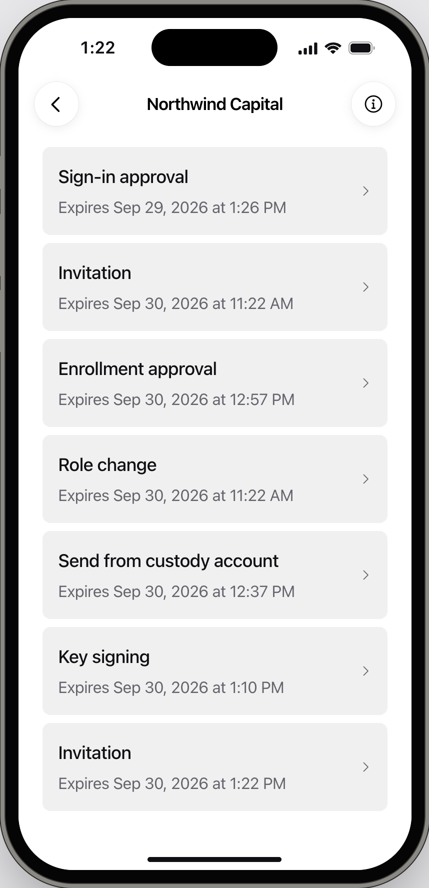
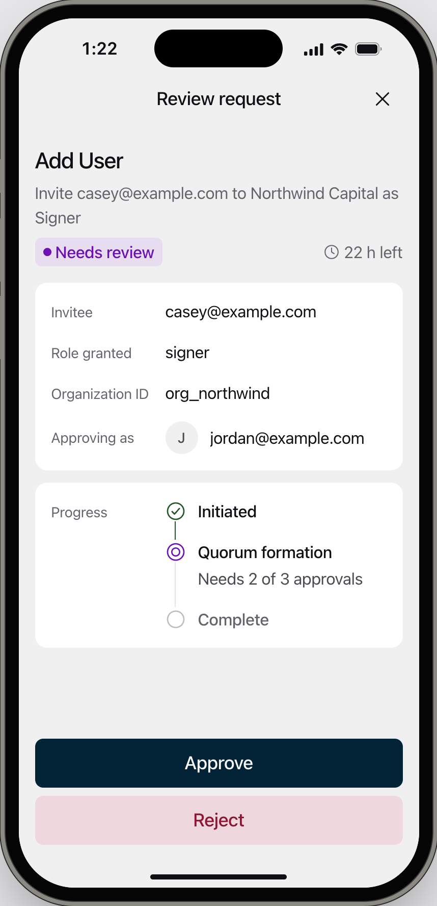
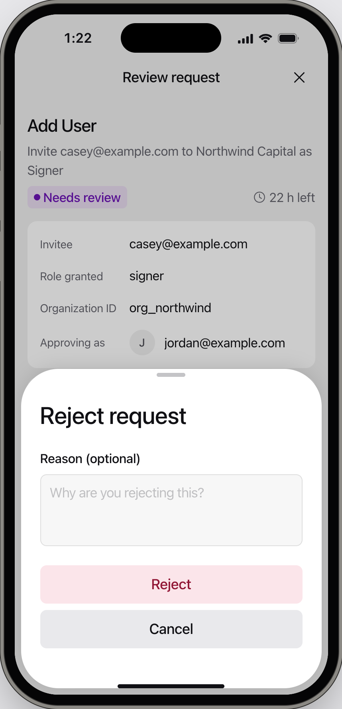

<Info>For approvers on the request, with an [enrolled iPhone](/onboarding/enroll-iphone). To approve a login, see [Log in to the console](/onboarding/log-in).</Info>

## Approving or rejecting a request

<Steps>
  <Step title="Open the request">
    Tap the "Approval required" notification, or open the Strongpoint Authenticator and unlock it with Face ID or Touch ID. The requests waiting for you are listed with their expiry time.

    <Frame caption="Figure 1: Requests waiting for you, with the time each one expires.">
      
    </Frame>
  </Step>
  <Step title="Check the details">
    The review screen shows the action, its details, the account you are approving as, and how many approvals the request needs.

    <Frame caption="Figure 2: The review screen for an invitation that needs 2 of 3 approvals.">
      
    </Frame>
  </Step>
  <Step title="Approve or reject">
    - **To approve.** Tap **Approve**, then **Approve** again.
    - **To reject.** Tap **Reject**, optionally add a reason, then tap **Reject** again. People who can see the request in the console see your reason.

    <Frame caption="Figure 3: Rejecting a request, with an optional reason.">
      
    </Frame>
  </Step>
  <Step title="Confirm with Face ID or Touch ID">
    Confirm with Face ID or Touch ID. The app returns to your requests and shows "You approved the request" or "You rejected the request".
  </Step>
</Steps>

## If it does not work

In the messages below, iPhones with Touch ID show "Touch ID" in place of "Face ID".

| What you see | What to do |
|---|---|
| No notification | Open the Strongpoint Authenticator. The request is listed there, and on **Approvals > Needs your review** in the console. |
| "Request expired" | The approval window closed before you responded. The person who started it can start a new request. |
| "Already decided" | You already responded from another device. No action needed. |
| "Request approved" or "Request rejected" | Other approvers resolved the request first. No action needed. |
| "Request cancelled" or "This request was cancelled" | The person who started it withdrew it. No action needed. |
| "Request failed" | The request could not complete. No action needed. |
| "No longer active" | The request expired or was already handled. No action needed. |
| "Can't display this request" | Check your connection and open the request again. If it keeps happening, update the Strongpoint Authenticator from the App Store. |
| "Face ID is locked. Unlock your iPhone first." | Unlock your iPhone with its passcode, then try again. |
| "Face ID is off for Strongpoint. Turn it on in Settings." | Allow Face ID for Strongpoint in iOS **Settings**, then try again. |
| "Not sent. Face ID didn't confirm it." | Try again and confirm with Face ID. |
| "Face ID or Touch ID changed" | Changing Face ID or Touch ID erased this iPhone's keys. Ask an Owner or Admin to remove the device and [send you a device enrollment](/organisation/send-device-enrollment). |
| "Decision not recorded" | Open the request again. If it happens again, contact [Strongpoint support](mailto:support@strongpoint.projecteleven.com). |
