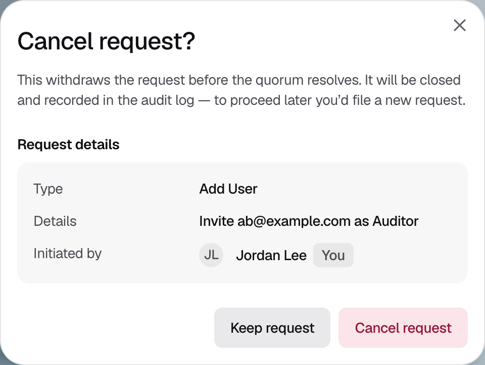

<Info>Available to the person who started the request, while the request is open.</Info>

## Canceling a request

<Steps>
  <Step title="Open the request">
    On **Approvals**, open **All**. Requests you started show **You** under **Initiated by**. Click the request.
  </Step>
  <Step title="Choose Cancel request">
    In the request details, click **⋮** and choose **Cancel request**.
  </Step>
  <Step title="Confirm">
    Check the request details, then click **Cancel request**. The request closes as **Cancelled**. To go ahead later, start a new request.

    <Frame caption="Figure 1: Confirm the request you are withdrawing.">
      
    </Frame>
  </Step>
</Steps>

{/* TK: the cancel dialog says cancellations are "recorded in the audit log", but rs/approvals/src/cancel.rs emits no audit entry. Confirm with backend before documenting it. */}

## If it does not work

| What you see | What to do |
|---|---|
| **Cancel request** is missing from the menu | The request is closed, its approval window has passed, someone else started it, or you already tried to cancel it in this session. |
| "The request was resolved before it could be cancelled." | The approvers finished first. Check the outcome in the request details. |
| "Cancellation pending" | Wait for the status to update. |
| "Cancellation rejected" | Strongpoint did not accept the cancellation. Reload the page to see the request's current status. |
| "Cancellation status unknown" | Close the dialog and wait for the status to update. |
