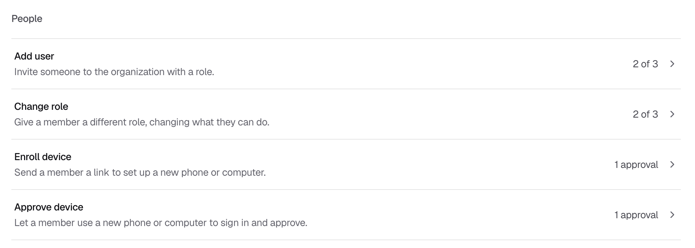
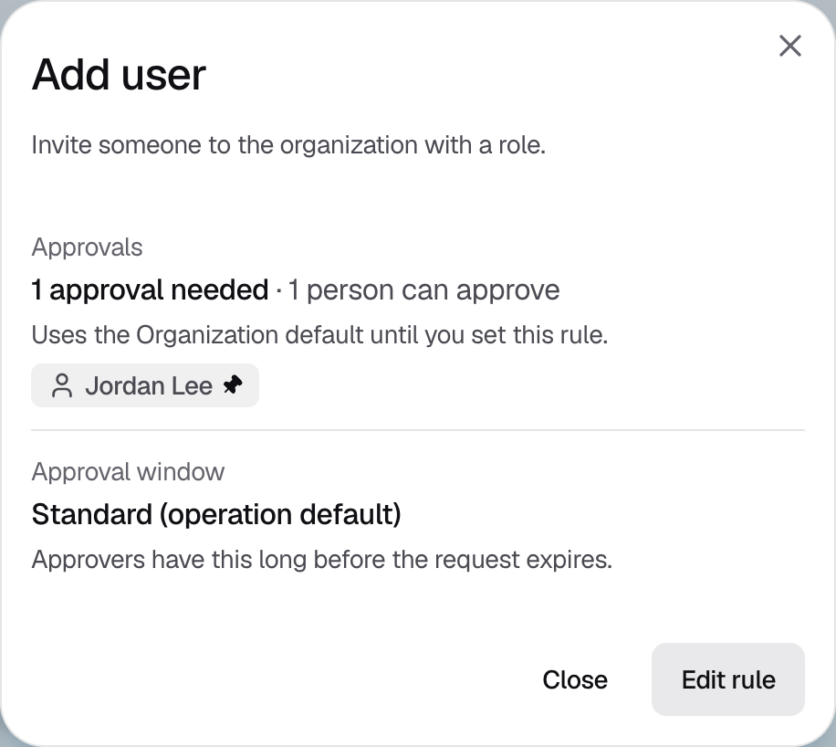

<Info>Requires the Owner or Admin role. Each change is itself an approval request, decided by the **Update approval policy** rule.</Info>

## Changing an approval rule

<Steps>
  <Step title="Open the rule">
    Go to **Policies**, stay on **Approval requirements**, and click the action you want to change, for example **Add user**. An action without its own rule follows **Organization default**.

    <Frame caption="Figure 1: Each action shows how many approvals it needs.">
      
    </Frame>
  </Step>
  <Step title="Start editing">
    Check the current approvals and approval window, then click **Edit rule**.

    <Frame caption="Figure 2: The current rule for Add user.">
      
    </Frame>
  </Step>
  <Step title="Choose who can approve">
    Click **Select approvers** and pick roles, people, or both. See [who can approve](/policies-and-approvals/policies#who-can-approve). Set **Approvals needed**, then click **Continue**. For **Organization default**, the button is **Review**.
  </Step>
  <Step title="Set the approval window">
    Choose how long approvers have: **Standard (24 hours)**, **1 hour**, **8 hours**, **24 hours**, **48 hours** or **7 days**. Then click **Review**. **Organization default** always uses the standard window, so it skips this step.
  </Step>
  <Step title="Save">
    If the console shows "This makes add user easier to authorize", the new rule needs fewer approvals than today. Check that this is what you want.

    Click **Save policy**. The console shows "Sent for approval", and the rule shows **Update pending approval** until approvers approve the change. To remove an action's own rule so it follows **Organization default** again, click **Delete override** instead.
  </Step>
</Steps>

{/* TK: the console's review step says "The new rule takes effect as soon as you save", but the backend always sends rule changes for approval. Ask product to align the console copy. */}

## If it does not work

| What you see | What to do |
|---|---|
| "Inactive approvers on this policy" | Replace approvers who no longer qualify with active members. |
| "Removed approvers must be replaced" | Choose active members in place of people who left the organization. |
| A member shows "No enrolled device" or "Invitation pending" | They become selectable once they [enroll an iPhone](/onboarding/enroll-iphone). |
| "You do not have permission to save approval policies." | Ask an Owner or Admin to make the change. |
| "Failed to save this approval policy." | Try again. If it keeps happening, contact [Strongpoint support](mailto:support@strongpoint.projecteleven.com). |
