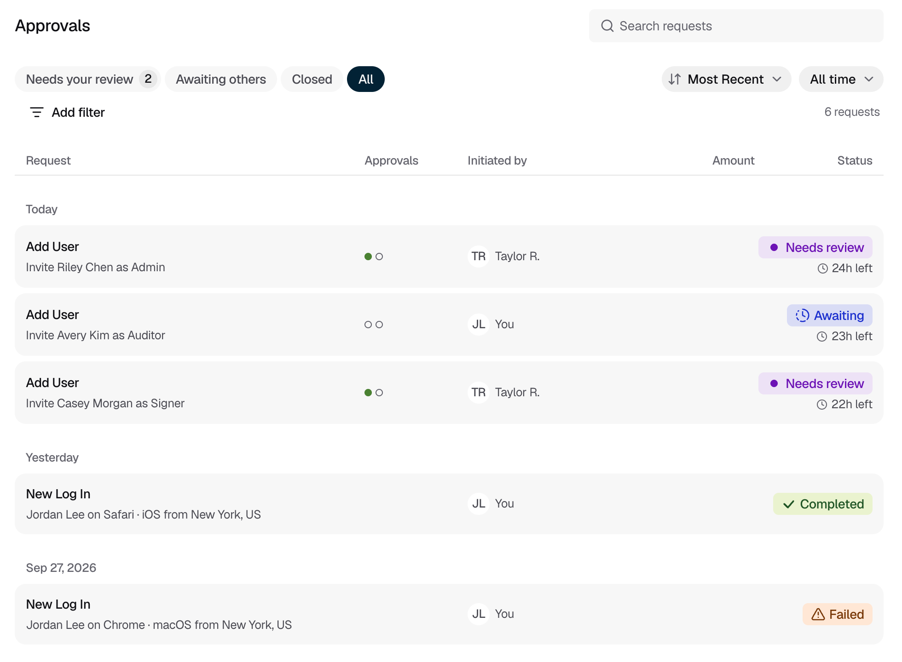
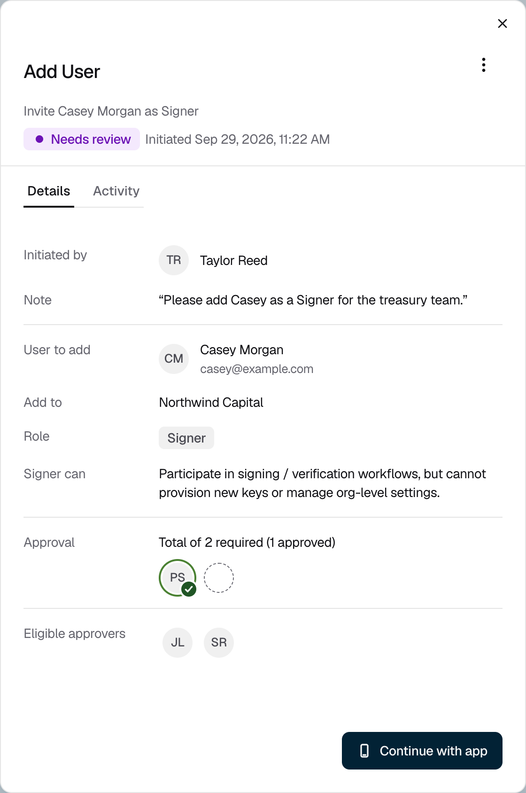

Use **Approvals** in the console to find a request and see where it stands.

## Tracking a request

<Steps>
  <Step title="Open Approvals">
    In the console sidebar, click **Approvals**. The number next to it is how many requests are waiting for your decision.
  </Step>
  <Step title="Choose a tab">
    | Tab | Shows |
    |---|---|
    | **Needs your review** | Open requests waiting for your decision, except logins |
    | **Awaiting others** | Open requests you have approved or rejected, waiting on other approvers |
    | **Closed** | Requests that have finished, whatever the outcome |
    | **All** | Every request you started or can approve, including logins |

    <Frame caption="Figure 1: The All tab, with each request's approvals, who started it, and its status.">
      
    </Frame>
  </Step>
  <Step title="Narrow the list">
    Search by name, email, action, or request ID. Use the sort and time menus, or click **Add filter** to filter by **Type** or **Key ring**. On **Closed** and **All**, you can also filter by **Status** and **Reviewer**.
  </Step>
  <Step title="Open the request">
    Click a request. **Details** shows what the request does, who started it, and who has approved. **Activity** shows each stage from start to finish. To approve or reject, use the Strongpoint Authenticator on your iPhone. The **Continue with app** button is not active yet.

    <Frame caption="Figure 2: The request details: who started it, what it does, and approvals so far.">
      
    </Frame>

    When a request you decided on finishes, the console shows a message with a **View** link.
  </Step>
</Steps>

## If it does not work

| What you see | What to do |
|---|---|
| A request you expect is missing | The page lists requests you started or can approve. Open **All**, clear any filters, and choose **All time**. |
| "Approval updates are temporarily unavailable. Showing the last loaded data." | Click **Try again**. |
| "Failed to load approvals." | Click **Try again**. If it keeps happening, contact [Strongpoint support](mailto:support@strongpoint.projecteleven.com). |
| "The decision window has ended. Waiting for the server to confirm the final status." | Wait a moment, or click **Try again**. |
| "This request expired, but its final status could not be confirmed." | Click **Try again**. If the status stays the same, contact [Strongpoint support](mailto:support@strongpoint.projecteleven.com). |
