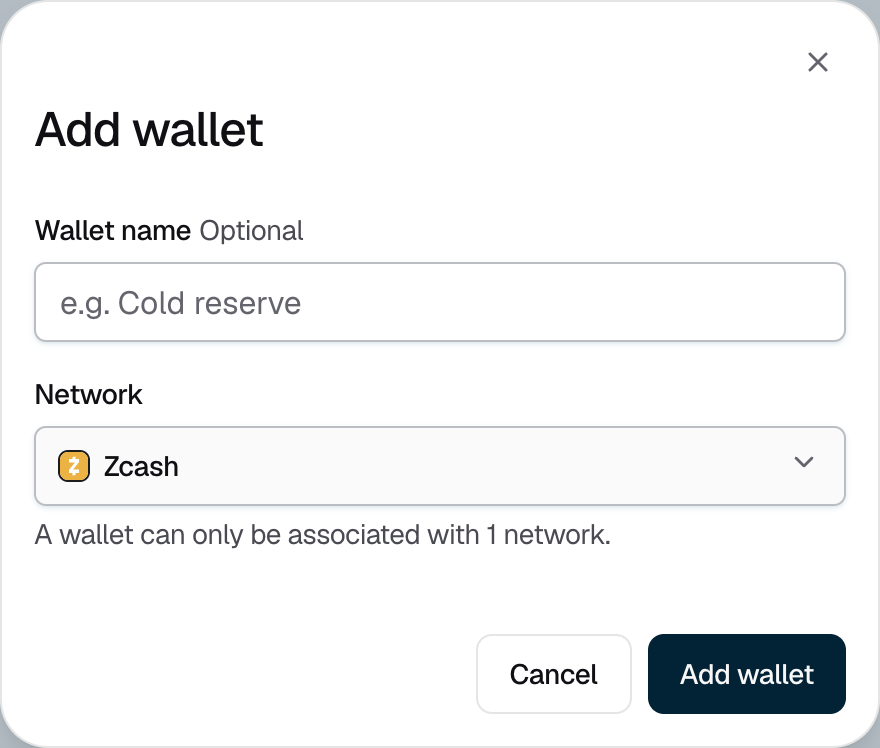

<Info>Requires the Owner or Admin role. Each new wallet is an approval request, decided by the account's **Manage** policy.</Info>

## Adding a wallet

<Steps>
  <Step title="Open the account">
    Go to **Portfolio**, open the account, and stay on the **Wallet** tab.
  </Step>
  <Step title="Name the wallet and choose its network">
    Click **Add wallet**. Enter a **Wallet name**, for example "Cold reserve", or leave it blank to use a name like "Wallet #2". Choose the **Network**. A wallet holds funds on one network only.

    <Frame caption="Figure 1: Each wallet holds funds on one network.">
      
    </Frame>
  </Step>
  <Step title="Request the wallet">
    Click **Add wallet**. The console shows "Approval requested", and the wallet shows **Setting up** until approvers approve its **Create Wallet** request. Once approved, the wallet is ready and gets its first address, so you can [receive funds](/portfolio/receive-funds) into it.
  </Step>
</Steps>

On a PEAK key ring, the key ring's holders must also contribute on their devices before the wallet is ready.

## If it does not work

| What you see | What to do |
|---|---|
| "A wallet named … already exists in this account." | Choose another name. Wallet names are unique within an account. |
| **Setup failed** | The request was rejected, or not enough approvers qualified. Add a new wallet to try again. |
| **Setting up** for a long time | The request is still waiting for approvals. Check it on the **Approvals** page. If it expired, add a new wallet. |
| "Could not create the wallet" | The account's key ring may not support that network. Choose a [supported network](/portfolio/supported-networks), then try again. |
