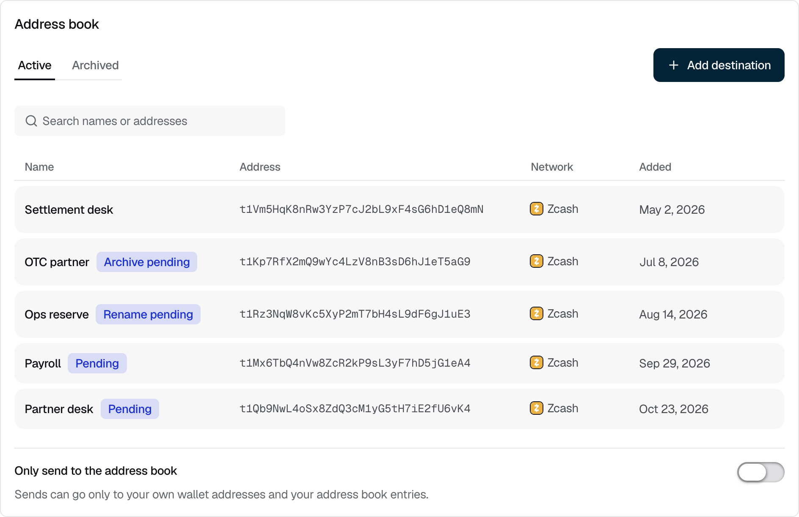
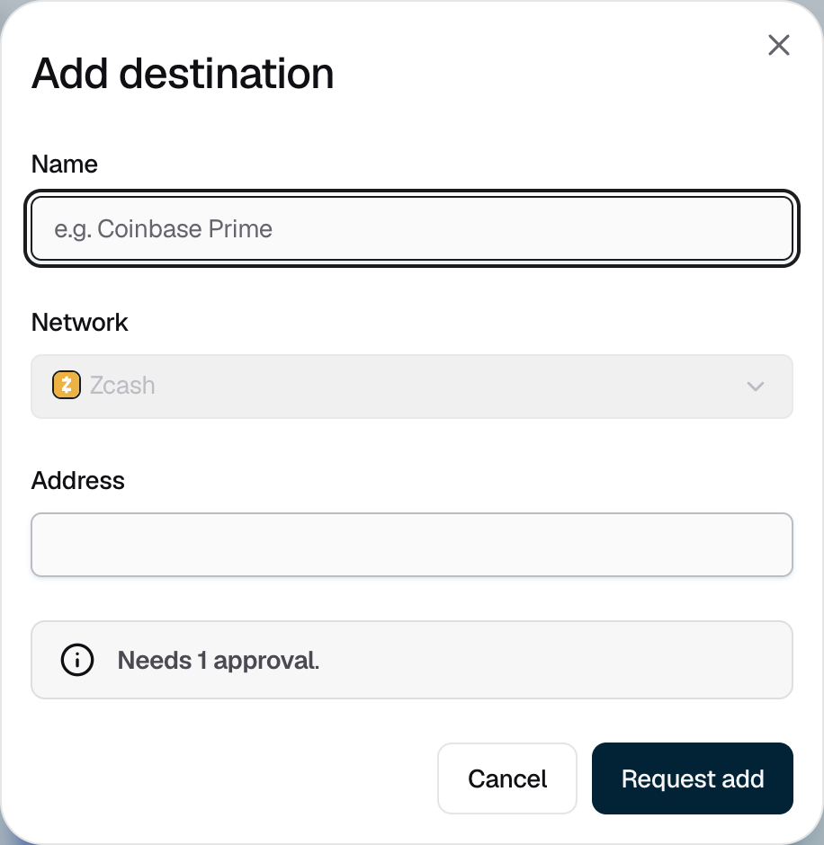

<Info>Requires the Owner or Admin role to make changes. Every role can view the address book.</Info>

Save the external addresses you send to, such as an exchange account or a partner's wallet. You can then pick them by name when you [send funds](/portfolio/send-funds), and approvers see that name.

To open the address book, click your name at the bottom of the sidebar, then **Settings**.

<Frame caption="Figure 1: Saved addresses, with changes still waiting for approval.">
  
</Frame>

## Adding an address

<Steps>
  <Step title="Enter the address">
    Click **Add destination**. Enter a **Name**, choose the **Network**, and paste the **Address**.

    <Frame caption="Figure 2: The dialog shows how many approvals the new address needs.">
      
    </Frame>
  </Step>
  <Step title="Request it">
    Click **Request add**. The address shows **Pending** until approvers approve it under your **Add address** policy. To withdraw your own pending request, click its **⋯** menu, then **Withdraw request**.
  </Step>
</Steps>

## Renaming or archiving an address

Click the address's **⋯** menu, then **Rename** or **Archive**, and confirm with **Request rename** or **Request archive**. Each change waits for approval under your **Rename address** or **Archive address** policy. An archived address moves to the **Archived** tab, and new sends can't use it.

## Allowing sends only to the address book

Turn on **Only send to the address book** to limit sends to your own wallets and saved addresses. Turning it on or off is an approval request, decided by your **Change approval rule** policy. Until approvers decide, the switch shows "Turning on · awaiting approvals" or "Turning off · awaiting approvals". The setting applies to new sends only.

## If it does not work

| What you see | What to do |
|---|---|
| "Enter a name." or "Enter an address." | Fill in the missing field. |
| "Already in the address book as …" | The address is saved under another name. Use that entry. |
| "Another address already has this name." | Choose a different name. |
| "Use 60 characters or fewer." | Shorten the name. |
| "Not a valid Zcash address." | Check that the address matches the network you chose. |
| "This network can't be used for the address book." | Choose a [supported network](/portfolio/supported-networks). |
| "This is one of your organization's own wallet addresses. Send to it directly; it doesn't need an entry." | Choose **Internal transfer** when you send to it. |
| "That's already its name." | Enter a different name, or close the dialog. |
| "Your role can view the address book but can't change it." | Ask an Owner or Admin to make the change. |

{/* TK: the console shows Add destination and the row actions to Signers too, but the server refuses their requests (rs/authz/cedar/policies.cedar). Ask engineering to hide them for Signers. */}
