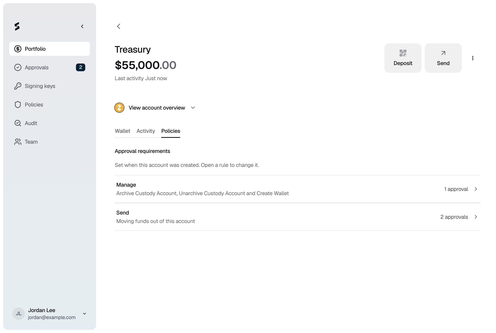

<Info>Requires the Owner or Admin role.</Info>

## Renaming an account

Open the account, click the **⋮** menu, then **Rename account**. Enter the new **Account name** and click **Save**. The new name applies right away, with no approval. Names must be unique across accounts.

To rename a wallet, click the wallet, then the **Wallet actions** menu, then **Rename wallet**.

## Changing an account's policies

Each account has two policies on its **Policies** tab:

- **Send** decides who approves moving funds out of the account.
- **Manage** decides who approves adding a wallet, and archiving or unarchiving the account.

<Frame caption="Figure 1: An account's Send and Manage policies.">
  
</Frame>

<Steps>
  <Step title="Open the policy">
    Open the account, go to **Policies**, and click **Send** or **Manage**. Then click **Edit**.
  </Step>
  <Step title="Choose who can approve">
    Click **Select approvers** and pick roles, people, or both. Set **Approvals needed**. For **Manage**, click **Continue** and choose the approval window. Then click **Review**.
  </Step>
  <Step title="Save">
    Check the new policy, then click **Save**. The change applies to this account only, and only after approvers approve it under your **Change approval rule** policy. Open requests keep the policy they started with.
  </Step>
</Steps>

## Archiving an account

Archive an account you no longer use. Its name becomes free to reuse, and the console hides **Deposit**, **Send** and **Add wallet** for it.

<Steps>
  <Step title="Empty the account">
    [Send](/portfolio/send-funds) any remaining funds out of every wallet in the account. You can't archive an account that still holds funds.
  </Step>
  <Step title="Archive it">
    Open the account, click the **⋮** menu, then **Archive Account**. Click **Archive** to confirm.
  </Step>
</Steps>

Archiving is an approval request, decided by the account's **Manage** policy. Once approved, the account moves to the **Archive** section of **Portfolio**. To bring it back, open it and click **Unarchive Account**. Unarchiving needs approval too.

## If it does not work

| What you see | What to do |
|---|---|
| **Archive Account** is greyed out, with "Send or sweep funds before archiving" | Send the remaining funds out of the account first. |
| "Another active account already uses this name." | Rename the active account with that name, then unarchive again. |
| "Action blocked" | Strongpoint can't raise the request, for example because too few approvers qualify. Ask an Owner or Admin to check the account's **Manage** policy. |
| "You do not have permission to change this account." | Ask an Owner or Admin to make the change. |
