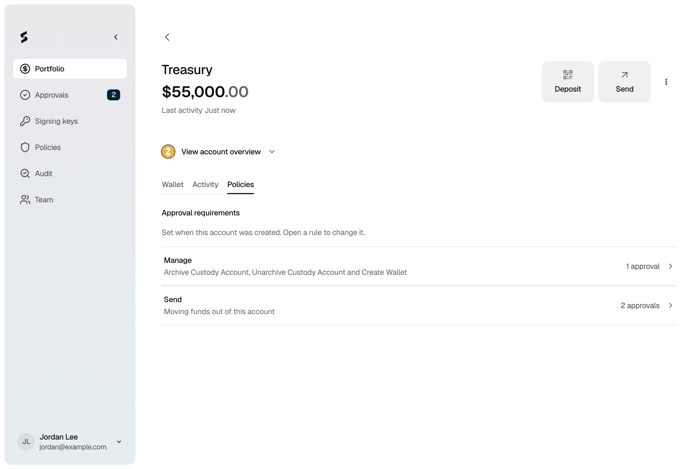

An account is the top level of your portfolio. It sets who can send its assets and who must approve, through its **Send** and **Manage** policies.

## Creating an account

<Info>Requires the Owner or Admin role.</Info>

Go to **Portfolio** and click **Add account**, then follow [Create an account](/onboarding/create-account). Strongpoint creates the account's key ring for you.

A new account needs approval from your organization's root key holders. The account's operators also approve, because they hold the shares of the account's key ring.

{/* TK: Tyler (Nov 2026) says creating an account needs approval from the root key holders and from the account's operators, who receive shares of its key ring. In the code, creating the account raises no approval of its own: each wallet raises a Create Wallet approval under the Manage policy, and PEAK key ring holders contribute their shares. Root key holders approve only when a PEAK key ring is created, and in production the user must create that key ring on Signing keys before adding the account. */}

## Renaming an account

<Info>Requires the Owner or Admin role.</Info>

Open the account, click the **⋮** menu, then **Rename account**. Enter the new **Account name** and click **Save**. The new name applies right away, with no approval. Names must be unique across accounts.

## Changing an account's policies

<Info>Requires the Owner or Admin role.</Info>

Each account has two policies on its **Policies** tab:

- **Send** decides who approves moving funds out of the account.
- **Manage** decides who approves adding a wallet, and archiving or unarchiving the account.

{/* TK: Tyler (Nov 2026) describes two account policies: who can start and approve sends, and who can add or remove people from the account's sender set. The code has no per-account sender set: anyone with the Owner, Admin or Operator role can start a send, and the Send policy decides only who approves. */}

<Frame caption="Figure 1: An account's Send and Manage policies.">
  
</Frame>

<Steps>
  <Step title="Open the policy">
    Open the account, go to **Policies**, and click **Send** or **Manage**. Then click **Edit**.
  </Step>
  <Step title="Choose who can approve">
    Click **Select approvers** and pick roles, people, or both. Set **Approvals needed**. For **Manage**, click **Continue** and choose the approval window. Then click **Review**.
  </Step>
  <Step title="Save">
    Check the new policy, then click **Save**. The change applies to this account only, and only after approvers approve it under your **Change approval rule** policy. Open requests keep the policy they started with.
  </Step>
</Steps>

## Archiving an account

<Info>Requires the Owner or Admin role. Archiving is an approval request, decided by the account's **Manage** policy.</Info>

Archive an account you no longer use. Its name becomes free to reuse, and the console hides **Deposit**, **Send** and **Add wallet** for it.

<Steps>
  <Step title="Empty the account">
    [Send](/portfolio/send-funds) any remaining funds out of every wallet in the account. You can't archive an account that still holds funds.
  </Step>
  <Step title="Archive it">
    Open the account, click the **⋮** menu, then **Archive Account**. Click **Archive** to confirm. Once approved, the account moves to the **Archive** section of **Portfolio**, and its key ring is disabled.
  </Step>
</Steps>

To bring an archived account back, open it and click **Unarchive Account**. Unarchiving needs approval too.

{/* TK: Tyler (Nov 2026) says archiving an account disables its key ring. In the code, archiving leaves the key ring unchanged, and KMS refuses to disable a key ring that backs an account (rs/kms/src/reserved_keyrings.rs). */}

## If it does not work

| What you see | What to do |
|---|---|
| **Archive Account** is greyed out, with "Send or sweep funds before archiving" | Send the remaining funds out of the account first. |
| "Another active account already uses this name." | Rename the active account with that name, then unarchive again. |
| "Action blocked" | Strongpoint can't raise the request, for example because too few approvers qualify. Ask an Owner or Admin to check the account's **Manage** policy. |
| "You do not have permission to change this account." | Ask an Owner or Admin to make the change. |
