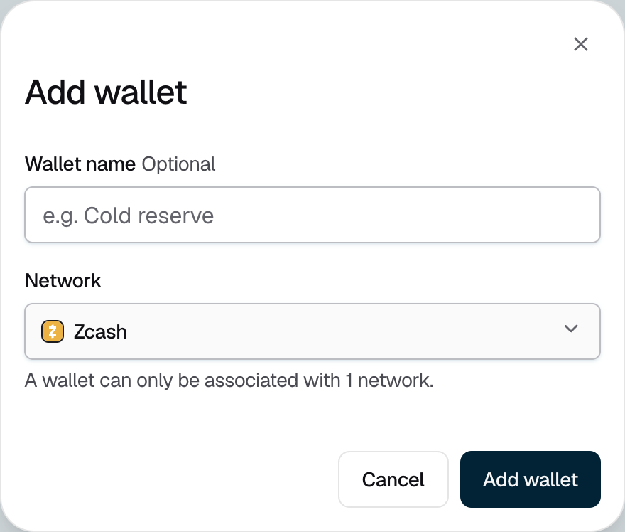

## Adding a wallet

<Info>Requires the Owner, Admin or Operator role. Each new wallet is an approval request, decided by the account's **Manage** policy.</Info>

{/* TK: Tyler (Nov 2026) says Operators on the account can add a wallet and approve it themselves. The code still limits Add wallet to Owners and Admins (rs/authz/cedar/policies.cedar, CreateWallet). */}

<Steps>
  <Step title="Open the account">
    Go to **Portfolio**, open the account, and stay on the **Wallet** tab.
  </Step>
  <Step title="Name the wallet and choose its network">
    Click **Add wallet**. Enter a **Wallet name**, for example "Cold reserve", or leave it blank to use a name like "Wallet #2". Choose the **Network**.

    <Frame caption="Figure 1: Each wallet holds funds on one network.">
      
    </Frame>
  </Step>
  <Step title="Request the wallet">
    Click **Add wallet**. The console shows "Approval requested", and the wallet shows **Setting up** until approvers approve its **Create Wallet** request. Once approved, the wallet is ready and gets its first address, so you can [receive funds](/portfolio/receive-funds) into it.
  </Step>
</Steps>

## Adding an address

<Info>Requires the Owner, Admin or Operator role. Adding an address needs no approval.</Info>

Click the wallet, go to its **Addresses** tab, and click **Generate address**. The new address appears in the list, ready to receive funds.

Some networks give a wallet only one address. For example, a Zcash wallet has one address, so **Generate address** doesn't appear once it has one. To receive at a new address on such a network, [add a wallet](#adding-a-wallet).

## Renaming a wallet

Click the wallet, then the **Wallet actions** menu, then **Rename wallet**. Enter the new name and click **Save**. Owners and Admins can rename wallets. Names must be unique within an account, and renaming needs no approval.

## If it does not work

| What you see | What to do |
|---|---|
| "A wallet named … already exists in this account." | Choose another name. |
| **Setup failed** | The request was rejected, or not enough approvers qualified. Add a new wallet to try again. |
| **Setting up** for a long time | The request is still waiting for approvals. Check it on the **Approvals** page. If it expired, add a new wallet. |
| "Could not create the wallet" | Choose a [supported network](/portfolio/supported-networks), then try again. |
| "This wallet cannot generate addresses yet." | The wallet's network doesn't support new addresses yet. See [Supported networks](/portfolio/supported-networks). |
| "Could not generate an address. Try again." | Try again. If it keeps happening, contact [Strongpoint support](mailto:support@strongpoint.projecteleven.com). |
