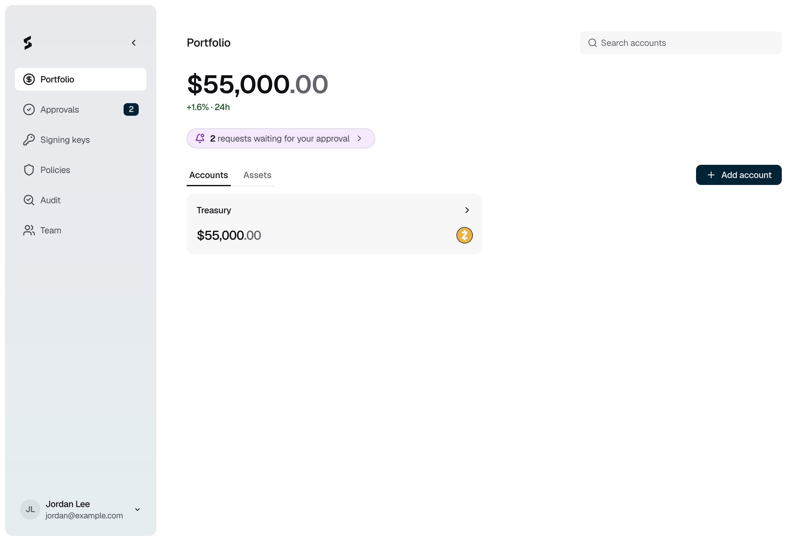

Portfolio is where Strongpoint holds your digital assets in custody. You keep assets in accounts, receive them at wallet addresses, and send them out once your approvers agree.

<Frame caption="Figure 1: Portfolio lists your accounts and their balances.">
  
</Frame>

## Accounts, wallets and addresses

- **Account.** An account groups the assets you manage together, for example "Treasury". Each account has its own **Send** and **Manage** policies, and its own signing [key ring](/kms/overview).
- **Wallet.** A wallet holds an account's funds on one network. An account can have several wallets.
- **Address.** An address is where a wallet receives funds. A wallet gets its first address as soon as it is set up.

## Supported networks

Strongpoint custody supports Zcash (ZEC) today, using transparent addresses. See [Supported networks](/portfolio/supported-networks) for details.

## What needs approval

| Action | Policy | Who can start it |
|---|---|---|
| Send funds | The account's **Send** policy | Owner, Admin |
| Add a wallet, archive or unarchive an account | The account's **Manage** policy | Owner, Admin |
| Add, rename or archive an address book entry | **Add address**, **Rename address**, **Archive address** | Owner, Admin |
| Change an account's **Send** or **Manage** policy, or turn on **Only send to the address book** | **Change approval rule** | Owner, Admin |
| Create an account, rename an account or wallet | No approval | Owner, Admin |

Signers and Auditors can view accounts, balances and activity. Approvers approve each request on their enrolled iPhone. See [Approvals](/policies-and-approvals/approvals).

## Tasks

<CardGroup cols={3}>
  <Card title="Create an account" icon="building-columns" href="/onboarding/create-account">
    Set up an account and choose who approves sends.
  </Card>
  <Card title="Receive funds" icon="arrow-down-to-line" href="/portfolio/receive-funds">
    Get a deposit address for an account.
  </Card>
  <Card title="Send funds" icon="paper-plane" href="/portfolio/send-funds">
    Request a transfer out of an account.
  </Card>
  <Card title="Add a wallet" icon="wallet" href="/portfolio/add-wallet">
    Hold an account's funds on another network.
  </Card>
  <Card title="Manage an account" icon="box-archive" href="/portfolio/manage-account">
    Rename, archive or change an account's policies.
  </Card>
  <Card title="Manage the address book" icon="address-book" href="/portfolio/address-book">
    Save the addresses you send to.
  </Card>
</CardGroup>

## Reference

- [Send and deposit statuses](/portfolio/transfer-statuses): what each status means.
- [Supported networks](/portfolio/supported-networks): networks, assets, confirmations and fees.
