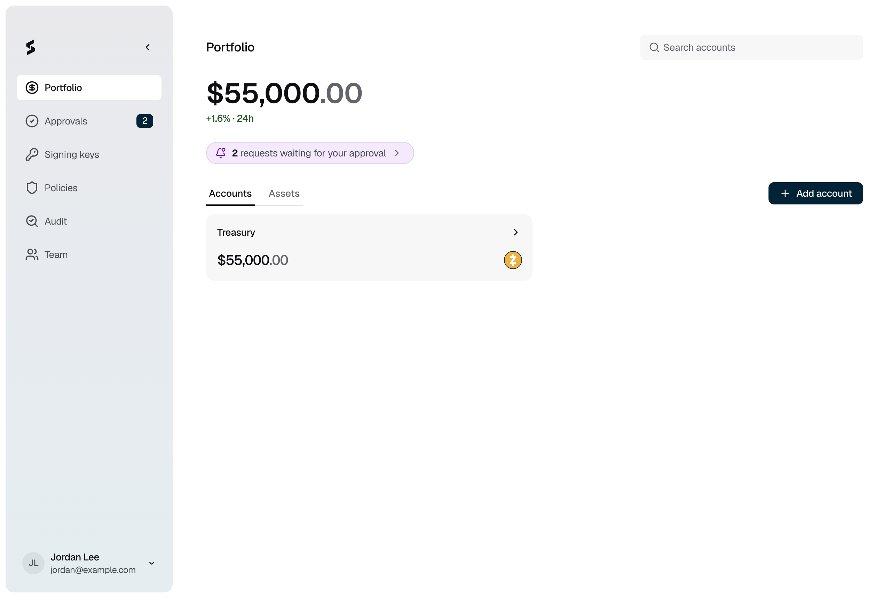

Portfolio is where you manage the digital assets you hold in Strongpoint.

<Frame caption="Figure 1: Portfolio lists your accounts and their balances.">
  
</Frame>

## Accounts, wallets and addresses

A portfolio is made up of accounts, wallets and addresses.

- **Account.** The top level of your portfolio. An account sets who can send its assets, and who must approve, through its **Send** and **Manage** policies.
- **Wallet.** Each account holds wallets. A wallet belongs to one network, and an account can have as many wallets as you need, across every [supported network](/portfolio/supported-networks).
- **Address.** Each wallet has one or more addresses. An address is where the wallet receives funds, and where those funds live on-chain.

## Tasks

<CardGroup cols={3}>
  <Card title="Manage accounts" icon="building-columns" href="/portfolio/manage-accounts">
    Create your first account, then rename, archive or change its policies.
  </Card>
  <Card title="Manage wallets" icon="wallet" href="/portfolio/manage-wallets">
    Add a wallet, or a new address to a wallet.
  </Card>
  <Card title="Receive funds" icon="arrow-down-to-line" href="/portfolio/receive-funds">
    Get a deposit address for an account.
  </Card>
  <Card title="Send funds" icon="paper-plane" href="/portfolio/send-funds">
    Request a transfer out of an account.
  </Card>
  <Card title="Manage the address book" icon="address-book" href="/address-book/overview">
    Save the addresses you send to.
  </Card>
</CardGroup>

## Reference

- [Send and deposit statuses](/portfolio/transfer-statuses): what each status means.
- [Supported networks](/portfolio/supported-networks): networks, assets, fees and block explorers.
