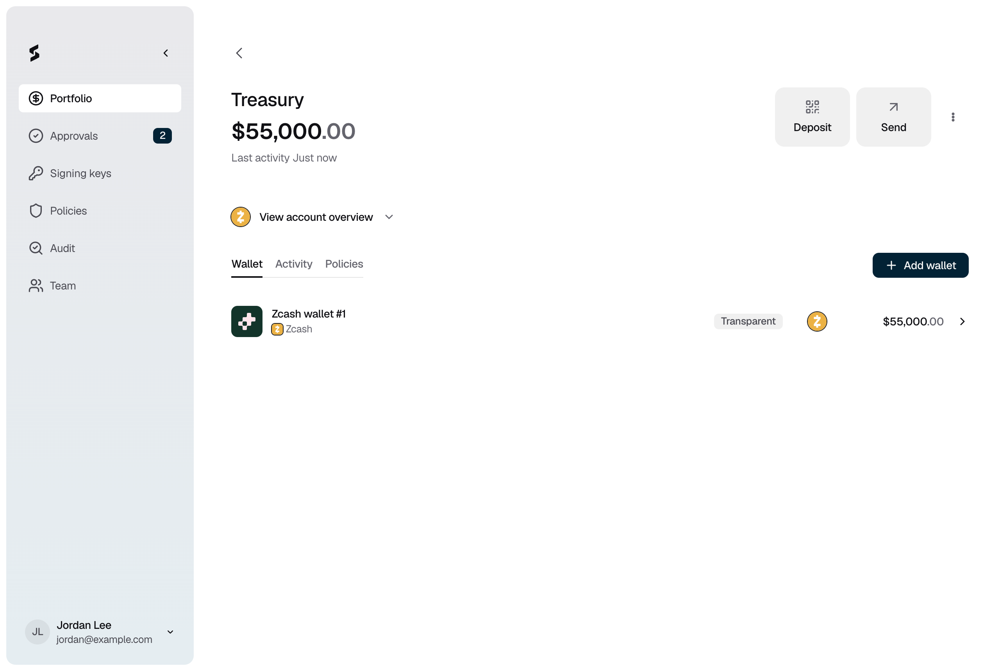
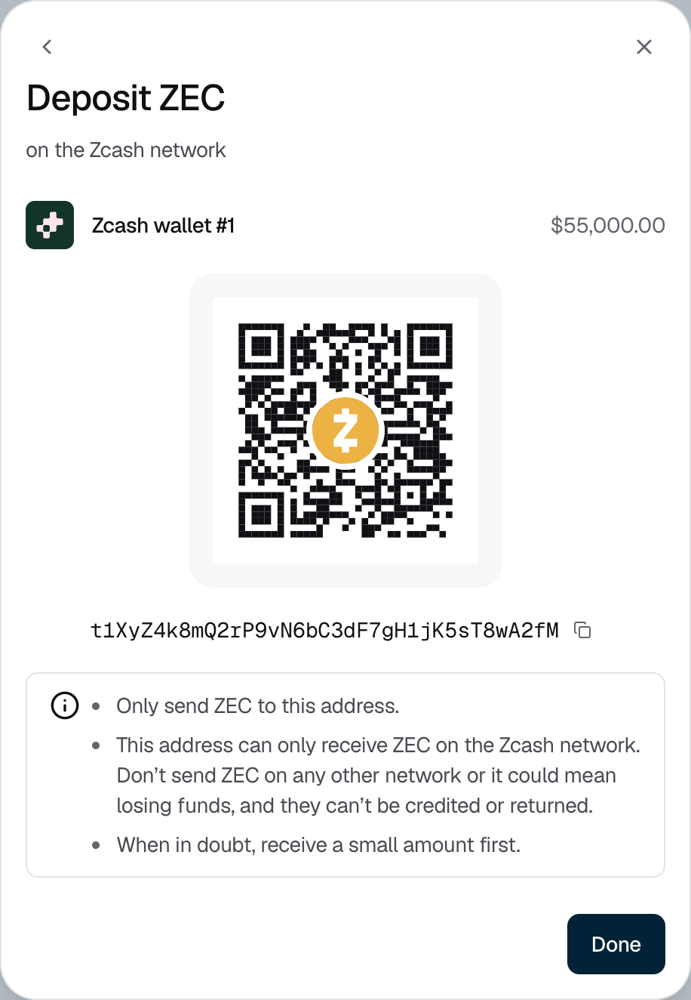

<Info>Any role can view deposit addresses. Receiving funds needs no approval.</Info>

## Getting a deposit address

<Steps>
  <Step title="Open the account">
    Go to **Portfolio** and click the account that should receive the funds.

    <Frame caption="Figure 1: The account page, with Deposit and Send at the top.">
      
    </Frame>
  </Step>
  <Step title="Choose the asset">
    Click **Deposit**, then choose the asset you want to receive, for example **ZEC**.
  </Step>
  <Step title="Choose the wallet">
    If the account has more than one wallet for that asset, choose the wallet that should receive it. With one wallet, the console skips this step.
  </Step>
  <Step title="Share the address">
    Click **Copy address**, or let the sender scan the QR code. Then click **Done**.

    <Frame caption="Figure 2: The deposit address for a Zcash wallet.">
      
    </Frame>
  </Step>
</Steps>

<Warning>Send only the asset shown, on the network shown. Funds sent on another network can't be credited or returned. When in doubt, send a small amount first.</Warning>

## When the funds arrive

Strongpoint checks each network about once a minute. A deposit appears on the account's **Activity** tab as **Receive**, with the status **Pending**. Once the network has confirmed it enough times, it shows **Received** and **Confirmed**, and counts toward the wallet's **Available** balance. A Zcash deposit needs 10 confirmations.

## If it does not work

| What you see | What to do |
|---|---|
| "No wallets on this account yet." | [Add a wallet](/portfolio/add-wallet) for the network you want to receive on. |
| "This wallet is still being set up." | The wallet is waiting for approval. Check its request on the **Approvals** page. |
| "Provisioning failed" | The wallet could not be set up. [Add a new wallet](/portfolio/add-wallet) and deposit into that one. |
| "Deposit addresses are not available yet." | The wallet's network can't receive funds yet. See [Supported networks](/portfolio/supported-networks). |
| A deposit stays **Pending** | The network has not confirmed it enough times yet. Check again in a few minutes. |
| A deposit does not appear at all | Check that the sender used the right address and network. If they did, contact [Strongpoint support](mailto:support@strongpoint.projecteleven.com) with the transaction ID. |
