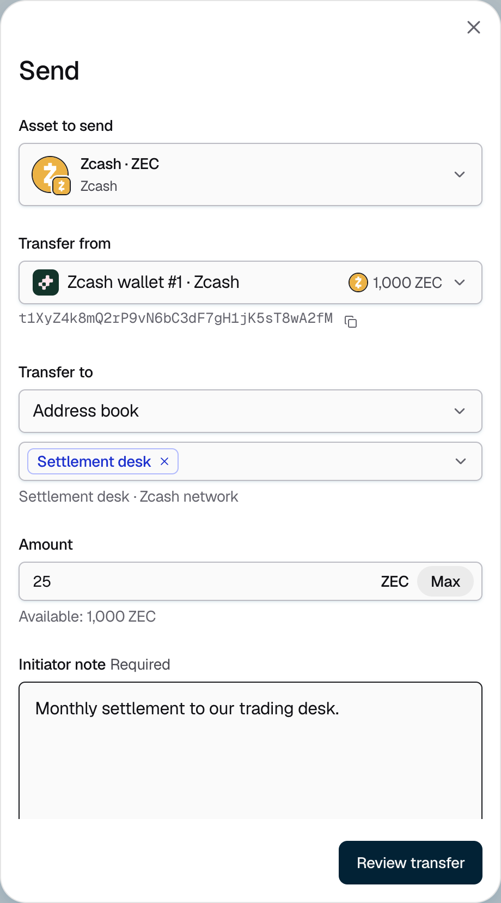
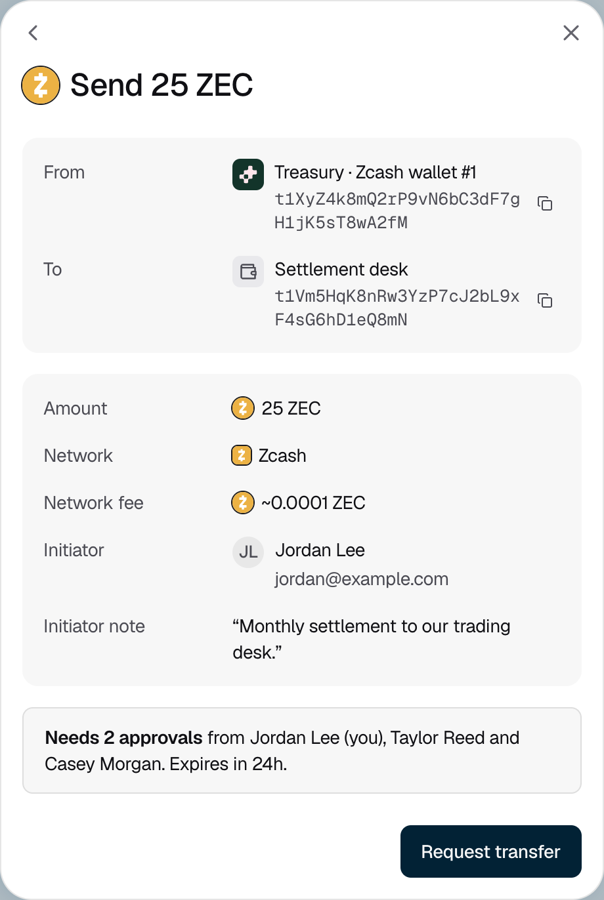

<Info>Requires the Owner or Admin role. Each send is an approval request, decided by the account's **Send** policy.</Info>

## Requesting a send

<Steps>
  <Step title="Open the send form">
    Go to **Portfolio**, open the account, and click **Send**.
  </Step>
  <Step title="Choose what to send and from where">
    Under **Asset to send**, choose the asset. Under **Transfer from**, choose the wallet the funds leave from.
  </Step>
  <Step title="Choose where it goes">
    Under **Transfer to**, choose one of these:

    - **Internal transfer** to send to another of your organization's wallets on the same network.
    - **Address book** to send to a saved address. See [Manage the address book](/portfolio/address-book).
    - **External transfer** to paste any other address.
  </Step>
  <Step title="Enter the amount and a note">
    Enter the **Amount**, or click **Max** to send the full available balance. Under **Initiator note**, say what the send is for. Approvers see this note. Then click **Review transfer**.

    <Frame caption="Figure 1: A send of 25 ZEC to a saved address.">
      
    </Frame>
  </Step>
  <Step title="Review and request">
    Check the destination, amount, network and network fee. The review also shows how many approvals the send needs and from whom. Click **Request transfer**.

    <Frame caption="Figure 2: The review shows the network fee and who must approve.">
      
    </Frame>

    The console shows "Submitted for approval". Approvers have 24 hours to approve. Once enough of them approve, Strongpoint signs and broadcasts the transaction. Follow its progress on the account's **Activity** tab. See [Send and deposit statuses](/portfolio/transfer-statuses).
  </Step>
</Steps>

## Available balance and fees

**Available** is what you can send now: your confirmed balance, minus funds held by sends still in progress and the network fee. Strongpoint sets the network fee for you.

## If it does not work

| What you see | What to do |
|---|---|
| "Amount exceeds available balance." | Lower the amount, or click **Max**. |
| "Zcash can't send less than 0.00000054 ZEC." | Raise the amount. Each network has a smallest amount it can send. |
| "Add a short note before continuing." | Fill in **Initiator note**. |
| "Not a valid Zcash address." | Check the address. It must be an address on the network of the wallet you send from. |
| "You can't send to the wallet you're sending from." | Choose a different destination. |
| "This address isn't in your address book." | You can still send. Check the address carefully first, or [save it to the address book](/portfolio/address-book). |
| **External transfer** is missing | Your organization allows sends only to your own wallets and saved addresses. [Add the address](/portfolio/address-book) to the address book first. |
| "Sending is coming soon." | The account has no wallet on a network that supports sending. See [Supported networks](/portfolio/supported-networks). |
| "You do not have permission to send from this account." | Ask an Owner or Admin to send the funds. |
| "Could not request the transfer. Try again." | Try again. If it keeps happening, contact [Strongpoint support](mailto:support@strongpoint.projecteleven.com). |
